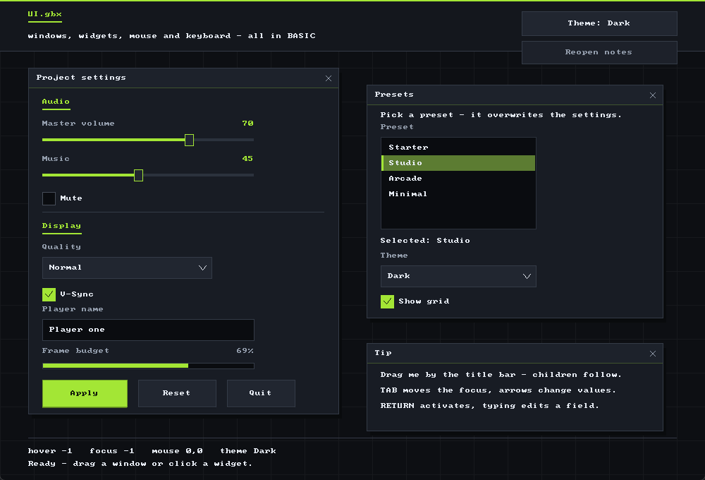
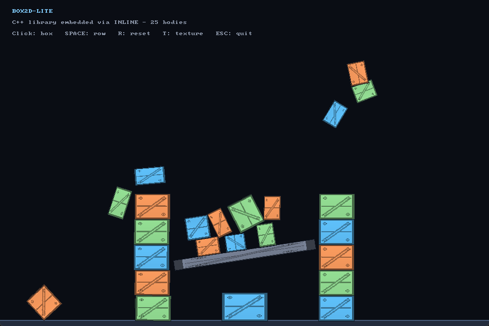
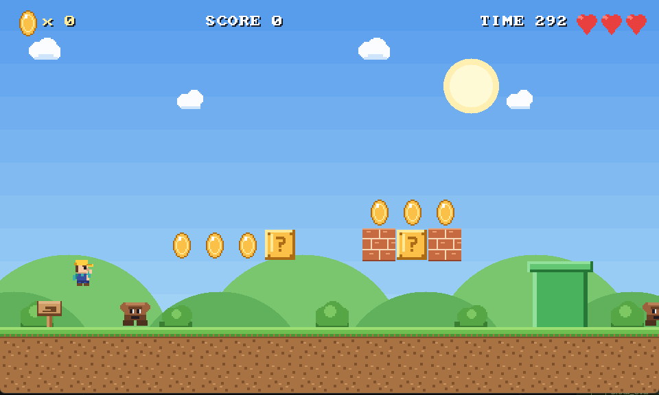
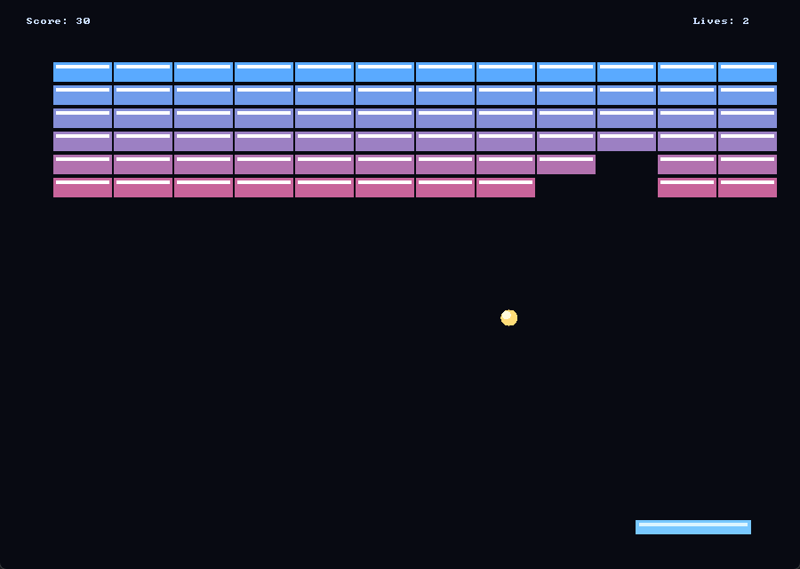
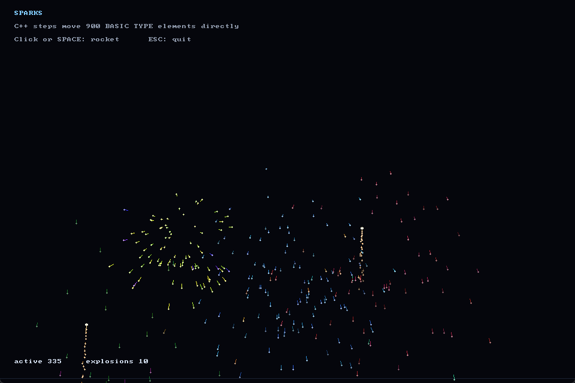
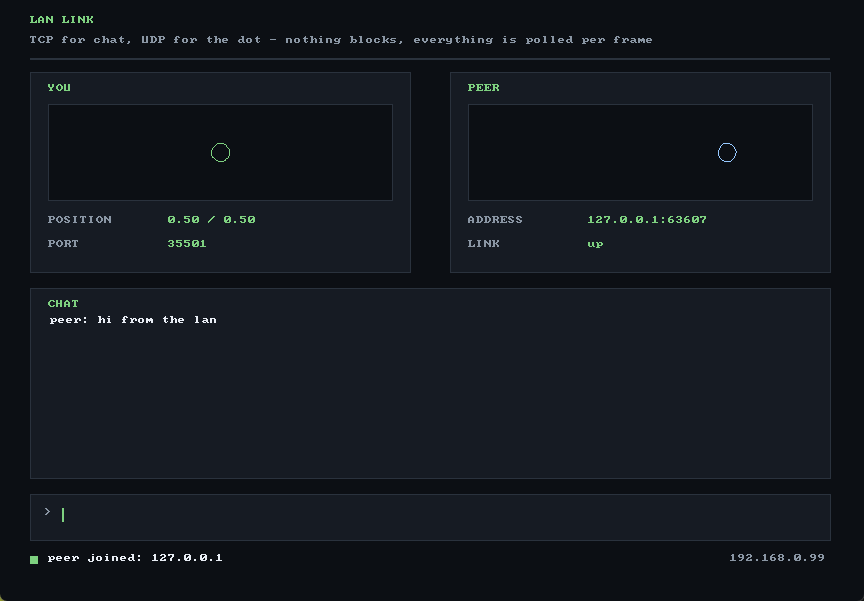
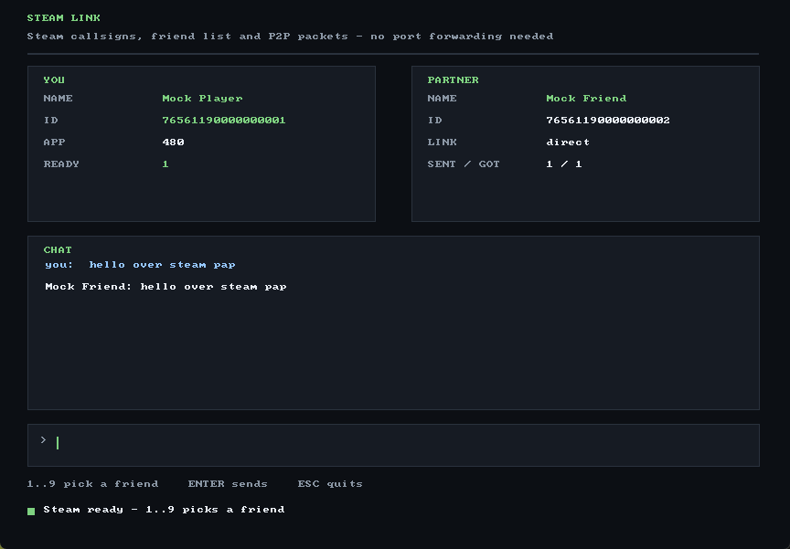

# GameBasiX


A BASIC interpreter for 2D games, built on **SDL3** – with direct C++ `INLINE`
blocks, sprites, sound, file access, TCP/UDP and Steam networking, and a
complete IDE. 3D and platform extras are deliberately out of scope; the 2D
core is complete.


<sub>**GBX Studio** – live name checking, outline, a searchable command reference
and a runtime debugger right next to the code.</sub>

## Highlights

* Language: BASIC with `$`/`%`/`#` suffixes, `FUNCTION`/`SUB`, `TYPE` with
  `METHOD`s, arrays, `SELECT CASE`, `TRY`/`THROW`
* Runtime: a C++17 interpreter (lexer → parser → AST), no compiler step in between
* Graphics: SDL3 renderer, PNG/JPG/BMP sprites, rotation/zoom, polygons,
  render targets, software alpha modes
* Text: built-in 8×8 bitmap font, bitmap fonts on a 16×8 grid and
  **TrueType through FreeType** (optional)
* Sound: a small software mixer for WAV sounds and music
* Inline C++: `INLINE` definitions and steps with direct access to BASIC
  variables, compiled once and cached
* Network: non-blocking TCP and UDP sockets (`NET*`/`UDP*`) plus Steam P2P
  packets and the friend list through the Steamworks flat API, loaded at
  runtime
* Tooling: **GBX Studio** with live checks, a debugger, single-file EXE and
  HTML5 export

Ready to try it? `cmake -S . -B build -G Ninja && cmake --build build`, then
`build/gbx.exe examples/09_ui/ui.gbxproj`.

## Screenshots

| | |
|:--:|:--:|
|  |  |
| **UI toolkit** – windows, widgets and themes in pure BASIC (`examples/09_ui`) | **Physics** – Box2D-Lite through `INLINE` (`examples/08_box2d`) |
|  |  |
| **Pip and the Golden Coins** – a platformer with tiles, enemies and sound (`examples/13_platformer`) | **Breakout** – a complete game in `examples/02_breakout` |
|  |  |
| **900 sparks** – C++ steps moving a `TYPE` array (`examples/06_sparks`) | **LAN link** – TCP chat, UDP cursor (`examples/11_net`) |
|  |  |
| **Steam link** – friends and P2P packets (`examples/12_steam`) | **GBX Studio** – editor, debugger, checks and export (`ide/`) |

## Building

Requirements (Windows, MSYS2 UCRT64): `g++`, `cmake`, `ninja`, and internet
access during the first configure (SDL3 is fetched with `FetchContent`).

```bash
cmake -S . -B build -G Ninja -DCMAKE_BUILD_TYPE=Release
cmake --build build
```

Result: `build/gbx.exe` and `GBXStudio.exe` in the project folder. The small
launcher opens the editor from `ide/` on double click (see [IDE](#ide)).

The version lives in one place: CMake reads `version` from `ide/package.json`
and passes it to `gbx.exe` (`--version`, the status bar of the editor) and to
the file properties of `GBXStudio.exe`. Bumping it there is enough for the next
build; only the lockfile keeps its own copy.

TTF fonts are included through FreeType when it is found
(MSYS2: `pacman -S mingw-w64-ucrt-x86_64-freetype`). Without FreeType
everything still builds, just without TTF:

```bash
cmake -S . -B build -G Ninja -DGBX_WITH_TTF=OFF
```

An already installed SDL3 can be used with `-DGBX_USE_SYSTEM_SDL=ON`.

For handing the build to someone else, `-DGBX_STATIC_RUNTIME=ON` links the
MinGW runtime and FreeType statically. `gbx.exe` and `GBXStudio.exe` then need
no `libstdc++-6.dll`, `libgcc_s_seh-1.dll`, `libwinpthread-1.dll` and no
`libfreetype-6.dll` – only Windows 10/11:

```bash
cmake -S . -B build-static -G Ninja -DCMAKE_BUILD_TYPE=Release -DGBX_STATIC_RUNTIME=ON
cmake --build build-static
```

## Running

```bash
build/gbx.exe examples/01_hello/hello.gbxproj   # start a project
build/gbx.exe examples/02_breakout/main.gbx     # a single source file
build/gbx.exe --headless tests/language_tests.gbx
build/gbx.exe --lang en --check main.gbx        # messages in English
```

Messages (syntax errors, runtime errors, name checks, help) are available in
German and English: `--lang de|en` or the `GBX_LANG` environment variable. The
IDE sets `GBX_LANG` itself to match the selected language.

| Option | Effect |
| --- | --- |
| `--headless` | no window and no sound; graphics commands become no-ops |
| `--tests` | like `--headless`, counts `ASSERT`s and prints a summary |
| `--check` | parse and check names, run nothing |
| `--syntax-only` | like `--check`, but without name checks (for individual part files) |
| `--stdin` | read the source from standard input (only with `--check`) |
| `--base <dir>`, `--name <file>` | base folder for `INCLUDE` and the file name in messages with `--stdin` |
| `--inline-cpp <file>` | write the generated C++ of the `INLINE` blocks (the HTML5 export links it in with Emscripten) |
| `--debug` | runtime debugger over stdin/stdout (breakpoints, single steps, variables) |
| `--version`, `-h/--help` | version or help |

Exit codes: `0` ok, `1` failed asserts, `2` syntax/runtime error, `3` internal
error.

`--check` does not only verify the syntax, it also checks names: anything the
program never defines is an error. It reports unknown commands (`bla`),
functions (`x = NOPE(1)`), variables (`PRINT foo`), labels (`GOTO later`) and
subroutines (`GOSUB missing`). Everything the program assigns, declares, uses
as a parameter or gets built in is known – including definitions from
`INCLUDE` files. Output parameters such as `INPUT name$` create their variable
themselves. While executing, GBX stays lenient: a variable that was never
assigned keeps returning the default value there.

Fields of TYPEs are checked as well: if the TYPE of a variable is known
(`LOCAL p AS POINT`, `DIM field[2] AS POINT`, parameter `p AS POINT`, also via
`q = p` and nested TYPEs), `p.x` has to be a field of that TYPE. `p.nam$`
then reports `Unknown field: NAM (POINT) – did you mean NAME?`. If the TYPE is
not unambiguous – for example because the same name is declared differently in
two functions – the check stays silent instead of guessing.

## Project file format

Instead of `.gbas`, GBX uses two clearly separated files:

* **`.gbx`** – source text (UTF-8, one statement per line, `'` or `//` as comment)
* **`.gbxproj`** – project file in INI style: window, entry point, FPS, asset folder
  and optionally C++ libraries for the `INLINE` blocks

Example `hello.gbxproj`:

```ini
[project]
name = "Hello World"
main = "main.gbx"          ; entry point relative to the project file

[window]
title = "My game"
width = 800
height = 600
fullscreen = 0
resizable = 1

[graphics]
fps = 60                   ; 0 = unlimited
vsync = 1

[audio]
enabled = 1
volume = 1.0

[assets]
root = "assets"            ; additional search path for images/sounds
```

Asset paths are searched in this order: project directory,
`project directory/assets`, current directory. TTF names without a path are
additionally looked up in `%WINDIR%\Fonts` (so `"arial.ttf"` works directly).

A project can consist of several files: `INCLUDE "lib.gbx"` pulls in more
source at that place. The path is relative to the file that contains the
`INCLUDE`, so a file in a subfolder reaches its neighbours with
`"../core/lib.gbx"`. Included files may include further files to any depth, and
a file that is already part of the program is skipped - a diamond loads once.
Top-level code of an included file runs in include order; constants, `FUNCTION`s,
`SUB`s and `TYPE`s are shared by all files. A file that includes one that is
still being parsed is a cycle: the error names the chain
(`Cyclic INCLUDE: main.gbx -> a.gbx -> main.gbx`) instead of piling up duplicate
definitions. See
[`examples/14_includes`](#examples) for a console test of that.

### Foreign C++ libraries

A project that uses `INLINE` can link libraries that are already built –
`mylib.a` from another project, a helper object file, or an import library for
a DLL. The optional `[native]` section puts them into the `g++` call that
compiles the blocks:

```ini
[native]
libs = lib/mylib.a lib/native.a   ; archives (.a) and object files (.o)
libdirs = lib                     ; search folders, passed as -L
flags = -lmy -DFOO=1              ; further flags for the call
```

* Values are separated by spaces, relative paths start at the project folder.
* The archives are placed **behind** the source file, because a linker only
  pulls an archive apart once it knows the need for it. From two archives on
  they are wrapped in `-Wl,--start-group … --end-group`, so mutual references
  between them resolve in any order.
* The flags go behind the source as well: `-D`/`-I` apply to all files anyway,
  a link flag like `-lmy` has to stand after the object that uses it.
* Archives have to match the toolchain that compiles the blocks (MinGW-w64 GCC
  for the Windows build; an MSVC `.lib` does not fit). The bundled compiler has
  only the C++ frontend, so build the archive from `.cpp` with `g++.exe -c`; a
  library from a real C compiler (`gcc`) needs `extern "C"` in the header,
  C++ symbols need no wrapper.
* A missing archive is reported with its path instead of a bare linker error.
* Size and time stamp of the archives are part of the cache key: rebuilding a
  `.a` compiles the blocks again instead of reusing the old DLL.
* `--check` starts no compiler, and `--export` bakes the archives into the
  embedded DLL – a shipped game still needs no compiler and no `.a`.
* The HTML5 build compiles the blocks with Emscripten, so `[native]` applies to
  the desktop build only.

A header that registers commands from a library looks like any other `INLINE`
definition – it just calls into the archive:

```cpp
#include <gbx_inline.h>
#include "mylib.h"                     // declares my_add(int, int)

static void add(const GbxValue* args, int argc, GbxValue* ret) {
    gbxinline::retNum(ret, my_add(gbxinline::argNum(args, argc, 0), 2));
}
GBX_INLINE_FN("ADD2", 1, 1, add);
```

## The language at a glance

```basic
' comment
CONSTANT WIDTH = 800

TYPE POINT
  x AS FLOAT
  y AS FLOAT
  lives% = 3                 ' default value per instance
ENDTYPE

GLOBAL points AS POINT

FUNCTION distance: a AS POINT, b AS POINT
  dx = b.x - a.x
  dy = b.y - a.y
  RETURN SQR(dx * dx + dy * dy)
ENDFUNCTION

DIM field[10]              ' indices 0..9
field[0] = 5
field[-1] = 7              ' last element

FOR i = 10 TO 1 STEP -2
  field[i / 2] = i
NEXT

SELECT field[0]
CASE 1, 2
  DEBUG "small" + CHR$(10)
CASE 3 TO 9
  DEBUG "medium" + CHR$(10)
DEFAULT
  DEBUG "large" + CHR$(10)
ENDSELECT
```

**Values and types.** Numbers are `FLOAT` by default, integers use `%`, strings
use `$`; `#` forces `FLOAT`. On assignment the suffix converts the value
(`x$ = 5` becomes `"5"`). `TRUE`/`FALSE` are `1`/`0`.

**Operators.** `+ - * /`, comparisons `= <> < <= > >=`, `AND`, `OR`, `NOT`.
`/` always yields a decimal number, `MOD(a,b)` the integer remainder.

**Control flow.** `IF/THEN/ELSE/ELSEIF/ENDIF` (single-line as well), `FOR ... TO
... STEP`, `WHILE/WEND`, `REPEAT/UNTIL`, `SELECT/CASE/DEFAULT/ENDSELECT`,
`BREAK`, `CONTINUE`, `GOTO label:` inside one scope, `GOSUB sub`.

**Functions.** `FUNCTION name: p1, p2 = 0 … ENDFUNCTION` with `RETURN`, `EXIT`
for an early return, `STATIC` for persistent locals, `BYREF` for reference
parameters (also to array elements and TYPE fields). `SUB name: … ENDSUB` is a
parameterless procedure for `GOSUB`. The colon after the name is part of the
syntax and required, also without parameters: `FUNCTION name:` and `SUB name:`.
The same holds for `METHOD name:` inside a `TYPE`.

**Arrays.** `DIM a[10]`, up to 4 dimensions, `DIM a[10] AS TYPE`, `REDIM`
(keeps data; for TYPE arrays `REDIM a[10] AS TYPE`), `DIMPUSH`, `DIMDEL`,
`DIMDATA`, `ARRAY_BOUNDS(a[], dim)`, `LEN(a[])`, `FOREACH x IN a[] … NEXT`
(BYREF to the element).

**TYPE.** Fields without a suffix are `FLOAT`, `$` makes strings, `AS
OtherType` nests. `LOCAL v AS TYPE`, `GLOBAL v AS TYPE`, `DIM arr[5] AS TYPE`.
Fields may carry a default value: `lives% = 3`, `name$ = "new"`, also
`total% = a + b` or a constant. The expression runs for every new instance –
for `LOCAL`, `GLOBAL` and every element of a TYPE array. `TYPE` values are
shared by reference (fields and arrays are pointers).

**Methods.** A `TYPE` can carry `METHOD`s. They live in the TYPE block and are
called with `object.name(...)`:

```basic
TYPE BOX
  w AS FLOAT
  h AS FLOAT

  METHOD area:
    RETURN w * h
  ENDMETHOD

  METHOD scale: factor
    w = w * factor
    h = h * factor
  ENDMETHOD
ENDTYPE

LOCAL b AS BOX
b.w = 4
b.h = 2
PRINT b.area(), 0, 0     ' 8
b.scale(3)
PRINT b.w, 0, 0          ' 12
```

Inside the body the fields of the type itself are visible like variables;
assignments write straight into the object. `self` stands for the object
itself, so `self.x` and `self.area()` – handy for passing the object to
another function. Parameters and `LOCAL` shadow a field with the same name.
Method names written without an object count as `self.method(...)` – so
`scale(2)` calls the object's own method. Methods work on variables, TYPE
fields and elements of TYPE arrays. `FUNCTION` and `SUB` inside a `TYPE` are
rejected by the parser with a hint to use `METHOD`.

**Errors.** `TRY … CATCH err$ … FINALLY` catches runtime errors; `THROW "text"`
raises one yourself. `FINALLY` ends the block (there is no separate FINALLY
body).

## Command reference

A one-page summary of every command, grouped by command type, is in
[CHEATSHEET.png](CHEATSHEET.png), generated by
[`python tools/make_cheatsheet.py`](tools/make_cheatsheet.py) from the IDE's
command dataset.

Version 1.2 renamed the built-in library so the names follow one scheme –
resource first (`SPRITE_DRAW`), no `GET` for value readers (`SCREEN_WIDTH`),
states as properties (`FILE_EXISTS`). [docs/commands-rename.md](docs/commands-rename.md)
lists every old name next to its new one for projects written with 1.0.

Commands marked with `*` are additions that go beyond the basic language.

**Window and screen**
`SCREEN_SET w,h,fullscreen` · `SCREEN_CLEAR [color]` (`-1` turns off automatic
clearing) · `SCREEN_BLACK` · `SCREEN_SHOW` · `LIMIT_FPS fps[,vsync]` ·
`SCREEN_SIZE w,h` · `DESKTOP_SIZE w,h` · `SCREEN_FULLSCREEN()` ·
`WINDOW_TITLE "text"`* · `SCREEN_WIDTH()`* · `SCREEN_HEIGHT()`* ·
`SET_VIEWPORT x,y,w,h` · `VIEWPORT x,y,w,h` · `SCREEN_SCALE w,h` ·
`SET_SMOOTHING on` · `SET_ALPHA_MODE a` · `SET_ALPHA_TEST value` ·
`SET_COLOR_KEY color`

**Drawing**
`RGB(r,g,b)` · `DRAW_LINE x1,y1,x2,y2,color` · `DRAW_RECT x,y,w,h,color` (filled) ·
`DRAW_RECT_BORDER x,y,w,h,color`* · `DRAW_CIRCLE x,y,r[,color]`* ·
`DRAW_CIRCLE_FILLED x,y,r[,color]`* · `PIXEL_SET x,y,color` · `PIXEL_GET(x,y)` ·
`POLY_BEGIN sprite,mode` · `POLY_POINT x,y,u,v,color` (u/v 0…1) · `POLY_STRIP` ·
`POLY_END`

**Sprites**
`SPRITE_LOAD "image.png", id` · `SPRITE_NEW()` · `SPRITE_DRAW id,x,y` ·
`SPRITE_DRAW_ROTATED id,x,y,angle` · `SPRITE_DRAW_ROTATED_SCALED id,x,y,angle,zoom%` ·
`SPRITE_DRAW_SCALED id,x,y,fx%,fy%` · `SPRITE_DRAW_STRETCHED id,x,y,w,h` ·
`ANIM_LOAD "sheet.png",id,tilew,tileh` · `ANIM_SET_TILES id,w,h` ·
`ANIM_DRAW id,frame,x,y` · `ANIM_DRAW_ROTATED_SCALED id,frame,x,y,angle,zoom%` ·
`ANIM_DRAW_STRETCHED id,frame,x,y,w,h` · `SPRITE_SIZE id,w,h` ·
`SPRITE_GRAB id,x,y,w,h` · `SPRITE_SAVE "file.png",id` ·
`SPRITE_COLLIDE(id1,x1,y1,id2,x2,y2)` · `ANIM_COLLIDE(...)` · `RECT_COLLIDE(x1,y1,w1,h1,x2,y2,w2,h2)`

**Image buffer and text**
`BACKGROUND_LOAD "image.png"` (background) · `SCREEN_SAVE_BMP "file.bmp"` · `SCREEN_TO_BACKGROUND` ·
`SCREEN_FADE "image.png"[,ms]` · `SCREEN_CREATE screen,sprite,w,h` ·
`SCREEN_USE id` · `PRINT "text",x,y[,kerning]` · `TEXT_DRAW "text",x,y[,color]`* ·
`TEXT_COLOR color`* · `FONT_LOAD "file",id[,size]` · `FONT_SET id[,scale[,color]]` ·
`FONT_SIZE w,h` · `FONT_CURRENT()` · `INPUT var,x,y` · `LEN(text[,pixels])`

**Input**
`KEY_DOWN(scancode)` · `KEY_PRESSED(scancode)`* · `INKEY$` · `MOUSE_STATE mx,my,left,right` ·
`MOUSE_AXIS(axis)` · `MOUSE_PRESSED(button)`* · `MOUSE_COUNT()` ·
`MOUSE_MOVE x,y` · `MOUSE_WAIT` · `KEY_WAIT` ·
`SET_SYSTEM_POINTER on` · `ALLOW_ESCAPE on`

Ready-made key codes: `KEY_ESC`, `KEY_ENTER`, `KEY_SPACE`, `KEY_TAB`,
`KEY_BACKSPACE`, `KEY_DELETE`, `KEY_HOME`, `KEY_END`, `KEY_PGUP`, `KEY_PGDN`,
`KEY_UP/DOWN/LEFT/RIGHT`, `KEY_LSHIFT/RSHIFT`, `KEY_LCTRL/RCTRL`,
`KEY_LALT/RALT`, `KEY_F1`…`KEY_F12`, `KEY_A`…`KEY_Z`, `KEY_0`…`KEY_9`.

**Sound**
`SOUND_LOAD "sound.wav",id[,buffer]` · `SOUND_PLAY(id,pan,volume)` → channel ·
`SOUND_STOP channel` · `SOUND_PLAYING(channel)` · `SOUND_STOP_ALL` · `SOUND_NEW()` ·
`MUSIC_PLAY "music.wav",loop` · `MUSIC_STOP` · `MUSIC_PAUSE on` ·
`MUSIC_VOLUME v` · `MUSIC_PLAYING()`

**Math**
`ABS` · `SGN` · `SQR` · `SIN` · `COS` · `TAN` (degrees) · `ASIN` · `ACOS` ·
`ATAN(dy,dx)` (degrees) · `FLOOR` · `CEIL` · `POW(a,b)` · `LOGN` ·
`MOD(a,b)` · `FMOD(a,b)` · `MIN` · `MAX` · `RND(max)` (0…max, inclusive) ·
`RND_SEED n` · `INTEGER` · `INTEGER64` · `NUMBER` · `SHL` · `SHR` ·
`BAND` · `BOR` · `BXOR` · `BNOT` · `IIF(condition, a, b)`

**Strings**
`LEN` · `LEFT$` · `RIGHT$` · `MID$(text,start[,length])` (0-based) ·
`INSTR(text,search[,start])` (0-based, `-1` = not found) · `INSTR_REVERSE` ·
`REPLACE$` · `SPLIT_STRING(text, array$[], separator[, empty])` · `UCASE$` · `LCASE$` ·
`TRIM$` · `LTRIM$` · `RTRIM$` · `ASC(text[,index])` · `CHR$` · `HEX$` ·
`FORMAT$(places,decimals,number)` · `STR$`* · `VAL`*

**Files**
`FILE_OPEN channel, file, mode` · `FILE_CLOSE channel` ·
`FILE_SEEK channel, offset, origin` · `FILE_POSITION(channel)` · `FILE_EOF(channel)` ·
`FILE_READ_BYTE channel, var%` · `FILE_READ_UBYTE channel, var%` · `FILE_READ_WORD channel, var%` ·
`FILE_READ_UWORD channel, var%` · `FILE_READ_LONG channel, var%` · `FILE_READ_ULONG channel, var%` ·
`FILE_READ_DOUBLE channel, var#` · `FILE_READ_FLOAT channel, var#` ·
`FILE_READ_STR channel, text$, count` · `FILE_READ_LINE channel, text$` ·
`FILE_WRITE_BYTE channel, value` · `FILE_WRITE_UBYTE channel, value` ·
`FILE_WRITE_WORD channel, value` · `FILE_WRITE_UWORD channel, value` ·
`FILE_WRITE_LONG channel, value` · `FILE_WRITE_ULONG channel, value` ·
`FILE_WRITE_DOUBLE channel, value#` · `FILE_WRITE_FLOAT channel, value#` ·
`FILE_WRITE_STR channel, text$` · `FILE_WRITE_LINE channel, text$` ·
`FILE_EXISTS(path)` · `FILE_SIZE(path)` · `FILE_COPY source, target` ·
`FILE_RENAME source, target` · `FILE_DELETE path` · `DIR_MAKE path`

**Network**
`NET_LISTEN port` · `NET_ACCEPT listener` · `NET_CONNECT host,port[,timeout]` ·
`NET_SEND handle,text` · `NET_RECV$(handle)` · `NET_PENDING(handle)` ·
`NET_CONNECTED(handle)` · `NET_PEER$(handle)` · `NET_PORT(handle)` · `NET_IP$` ·
`NET_CLOSE handle` · `NET_ERROR$` · `UDP_OPEN port` ·
`UDP_SEND handle,host,port,text` · `UDP_RECV$(handle)` · `UDP_FROM$(handle)` ·
`UDP_PORT(handle)` · `UDP_CLOSE handle`

**Steam**
`STEAM_INIT [appid]` · `STEAM_SHUTDOWN` · `STEAM_RUN` · `STEAM_READY()` ·
`STEAM_NAME$()` · `STEAM_ID$()` · `STEAM_APP_ID()` · `STEAM_FRIENDS()` ·
`STEAM_FRIEND_ID$(i)` · `STEAM_FRIEND_NAME$(i)` · `STEAM_FRIEND_STATE(i)` ·
`STEAM_P2P_SEND id,text[,channel[,reliable]]` · `STEAM_P2P_AVAILABLE([channel])` ·
`STEAM_P2P_RECV$([channel])` · `STEAM_P2P_FROM$()` · `STEAM_P2P_ACCEPT id` ·
`STEAM_P2P_CLOSE id` · `STEAM_P2P_STATE(id)` · `STEAM_ERROR$()`

**Runtime and debug**
`DEBUG` · `STDOUT` · `STDERR` · `STDIN$` · `SLEEP ms` · `DELTA_TIME()` ·
`ELAPSED_TIME()` · `COMMAND_LINE$()` · `SOURCE_LINE()` · `SOURCE_FILE$()` ·
`PLATFORM_INFO$("os")` · `ENV$` · `SET_ENV` · `ASSERT condition[,text]` ·
`END` · `WAIT_INPUT`

## Language details

* **Key codes**: `KEY_DOWN()`/`KEY_PRESSED()` take SDL3 scancodes; the `KEY_*` constants
  save you the lookup.
* **Formats**: `MID$`, `ASC` and `INSTR` are 0-based and `RND(max)` is
  inclusive. `SIN/COS/TAN` and `ATAN` work in degrees.
* **Arrays**: `DIM a[n]` gives the indices `0…n-1`, negative indices count from
  the end, at most 4 dimensions, `DIM a[0]` frees the memory.
* **Function headers**: `FUNCTION`, `SUB` and `METHOD` always take a colon
  after the name, also without parameters: `FUNCTION draw:`, `SUB reset:`,
  `METHOD clear:`. A missing colon is a syntax error with the line number.
* **GOTO/GOSUB**: `GOTO` only jumps inside the current scope (main program,
  `SUB` or `FUNCTION`) and only to labels on its top level. `GOSUB` calls
  `SUB`s; there are no return labels.
* **TRY/CATCH**: `FINALLY` ends the `TRY` block (no separate FINALLY body).
* **Music**: WAV only (no MP3/OGG), because no decoder is shipped.
  `MUSIC_PLAY` uses the same mixer.
* **Fonts**: `FONT_LOAD` loads `.bmp` fonts on a grid with 16 characters per
  row and 8 rows (characters 0–127) or – for `.ttf`/`.otf` or when a size is
  given – a TrueType font through FreeType. `FONT_SET id,scale` scales it.
  The kerning parameter of `PRINT` is ignored (bitmap fonts are monospaced).
* **SET_ALPHA_MODE** is approximate: `> 0` additive, `< 0` alpha `1+value`,
  `0` normal.
* **`SET_ALPHA_TEST`/`SET_COLOR_KEY`** apply while loading images, not
  retroactively to sprites that are already loaded.
* **`SCREEN_SAVE_BMP`/`SPRITE_GRAB`** need a real renderer; in `--headless` mode they
  report an error.
* **SCREEN_SCALE** uses SDL logical presentation; `SET_VIEWPORT` is then in window
  coordinates.
* **`INLINE`** compiles the C++ blocks with `g++` (the package ships one):
  definitions are loaded as a DLL at startup, steps run in the middle of the
  code (see [INLINE](#inline-c-inside-the-basic-program)). Prebuilt libraries
  come from the `[native]` section of the project file
  ([Foreign C++ libraries](#foreign-c-libraries)). There is no `IMPORT` or
  `REQUIRE`.
* **Network**: sockets never block. `NET_ACCEPT`, `NET_RECV$`, `UDP_RECV$` and
  `NET_PENDING` return immediately; only `NET_CONNECT` waits, at most for its
  timeout (default 3000 ms). Handles are positive integers and shared by TCP
  and UDP.
* **Browser**: the HTML5 player has no raw sockets, so the `NET*`/`UDP*`
  commands report an error there; Steam is desktop-only as well.

## Files and folders

`FILE_OPEN channel, file, mode` opens a file and binds it to a channel (a
positive integer): mode `1` reads, `0` writes a new file, `-1` appends. The
call returns `1` on success and `0` otherwise, for example when the file is
missing. `FILE_CLOSE channel` closes it and flushes the data.

Reading and writing are binary and little-endian: `BYTE` (1 byte), `WORD`
(2), `LONG` (4), `SHORTIEEE` (4-byte float) and `IEEE` (8-byte double), with
unsigned variants `FILE_READ_UBYTE`, `FILE_READ_UWORD` and `FILE_READ_ULONG` for values that
exceed the signed range. `FILE_READ_STR`/`FILE_WRITE_STR` move raw text,
`FILE_READ_LINE`/`FILE_WRITE_LINE` work line by line (`FILE_WRITE_LINE` appends CRLF and
`FILE_READ_LINE` trims it).

`FILE_SEEK channel, offset, origin` seeks with origin `0` (start), `1`
(current position) or `-1` (end); `FILE_POSITION` and `FILE_EOF` report where
the read position is. `FILE_EXISTS` and `FILE_SIZE` work without opening a
file, `FILE_COPY`, `FILE_RENAME` and `FILE_DELETE` change files, `DIR_MAKE`
creates folders (including missing parents).

Paths for reading are resolved like assets (project folder, `assets/`,
current folder). Writing, copying, renaming and `DIR_MAKE` target the project
folder – or the folder next to the EXE in a packaged game. In the browser the
files live in Emscripten's virtual file system, so writes last for the session
and are gone after a reload; reading bundled assets works as usual. A complete
demo is in `examples/10_fileio`.

```basic
FILE_OPEN 1, "save.dat", 0
FILE_WRITE_LONG 1, points
FILE_WRITE_LINE 1, name$
FILE_CLOSE 1

IF FILE_EXISTS("save.dat") THEN
  FILE_OPEN 1, "save.dat", 1
  FILE_READ_LONG 1, points
  FILE_READ_LINE 1, name$
  FILE_CLOSE 1
ENDIF
```

## Network and Steam

`NET_LISTEN port` starts a TCP server and returns a handle; port `0` picks a
free one and `NET_PORT` reports which. `NET_ACCEPT` hands out one connection per
call, or `0` when none is waiting. The other side uses `NET_CONNECT host, port`,
the only command that waits – at most for the timeout in milliseconds (default
`3000`). `NET_SEND` writes bytes, `NET_RECV$` returns everything that arrived
since the last call, `NET_PENDING` says how much is buffered. `NET_PEER$` names
the other side as `ip:port`, and `NET_IP$` is the machine's own IPv4 address –
the one a player on the LAN has to type in.

```basic
' server
listener = NET_LISTEN(35500)
IF listener = 0 THEN
  PRINT NET_ERROR$(), 10, 10
  END
ENDIF

conn = 0
WHILE conn = 0
  conn = NET_ACCEPT(listener)
  SCREEN_SHOW
WEND

WHILE 1
  msg$ = NET_RECV$(conn)
  IF msg$ <> "" THEN NET_SEND conn, "echo: " + msg$
  SCREEN_SHOW
WEND
```

`UDP_OPEN port` binds a datagram socket (`0` for any port, `UDP_PORT` reports
it). `UDP_SEND handle, host, port, text` sends one packet, `UDP_RECV$` returns
the next one and `UDP_FROM$` its sender as `ip:port`. Nothing is buffered on top
of the socket, so lost and reordered packets are your business – which is what
makes UDP right for positions that are replaced every frame.

`NET_ERROR$` keeps the last failure (`Port belegt`, `Verbindung abgelehnt`, …).
A `0` from `NET_LISTEN`/`NET_CONNECT` is not a runtime error, so a game can show
a message instead of stopping. `NET_CLOSE` closes servers and TCP connections,
`UDP_CLOSE` datagram sockets. The browser build has no sockets; there the
commands report an error.

### Steamworks

The `STEAM*` commands use the stable Steamworks flat API, which GameBasiX
loads at runtime – the project builds without the SDK. Copy `steam_api64.dll`
(Windows) or `libsteam_api.so` (Linux) next to the EXE, place `steam_appid.txt`
with the app id beside it (or pass the id to `STEAM_INIT`), and start the game
through Steam. `GBX_STEAM_LIB` points at a library in another folder, which is
how the test suite runs against a mock.

The library itself is Valve's, not part of GameBasiX: the SDK Access Agreement
allows shipping `redistributable_bin` binaries **together with your own game**
(1.1b), but not handing them out on their own. That is why `steam_api64.dll`,
`steam_api.dll`, `libsteam_api.so`, `libsteam_api.dylib` and `steam_appid.txt`
are in `.gitignore` – take the DLL from the SDK you downloaded yourself and keep
it next to the EXE. `steam_appid.txt` is a development helper only (it lets you
run without starting through Steam); in a released build Steam supplies the app
id, so the file should not be shipped. The mock in `tools/` is GameBasiX's own
code and is free to sit in the repository.

Flat-API entry points are versioned (`SteamAPI_SteamUser_v023`,
`SteamAPI_SteamNetworking_v006`, …), and the numbers move between SDK
releases. GameBasiX therefore resolves the accessors while it loads the
library, so any recent SDK works without a rebuild; verified against Steamworks
SDK 1.65. Without the library, without a running Steam client or without a
valid app id the commands stay `0` and `STEAM_ERROR$()` reports the reason –
including Steam's own message such as `Cannot create IPC pipe to Steam client
process`.

Steam itself writes two lines to the console while it starts
(`Setting breakpad minidump AppID = 480`, then
`SteamInternal_SetMinidumpSteamID: … [API loaded no]`). They are Steam's own
diagnostics for its crash reporter and appear even when everything works; the
`no` there does not refer to GameBasiX. After that the program prints nothing
more unless it asks for it – `STEAM_READY()`, `STEAM_NAME$()` or `STEAM_ERROR$()`
are the real status.

```basic
IF STEAM_INIT(480) = 0 THEN
  PRINT "Steam: " + STEAM_ERROR$(), 10, 10
  END
ENDIF

PRINT STEAM_NAME$() + "  " + STEAM_ID$(), 10, 10
FOR i = 0 TO STEAM_FRIENDS() - 1
  PRINT STEAM_FRIEND_NAME$(i) + "  " + STEAM_FRIEND_ID$(i), 10, 40 + i * 20
NEXT

WHILE 1
  STEAM_RUN                       ' pumps Steam's callbacks, once per frame
  packet$ = STEAM_P2P_RECV$(0)     ' "" while nothing arrived
  IF packet$ <> "" THEN PRINT STEAM_P2P_FROM$() + ": " + packet$, 10, 300
  SCREEN_SHOW
WEND
```

`STEAM_P2P_SEND id, text [,channel [,reliable]]` sends to another Steam user;
the receiver reads it with `STEAM_P2P_RECV$` and finds the sender in
`STEAM_P2P_FROM$`. The first packet opens the session, `STEAM_P2P_ACCEPT` accepts
it explicitly, `STEAM_P2P_STATE id` reports `0` none, `1` connecting, `2` direct
and `3` through Steam's relay – the relay is what makes this work without port
forwarding. Reliable packets (`1`, the default) arrive in order; `0` is meant
for state that the next packet replaces anyway.

Steam IDs are 64-bit numbers and are therefore passed as strings; a FLOAT would
lose digits. `STEAM_READY()` tells whether the API is up, `STEAM_ERROR$()` why it
is not, and `STEAM_SHUTDOWN` releases it. Lobbies and the newer
`ISteamNetworkingSockets` are not covered – the old P2P packet API is enough for
host/join by ID and needs no callback machinery.

## INLINE: C++ inside the BASIC program

`INLINE … ENDINLINE` puts C++ code straight into the program. The position
decides what the block is:

* **Definitions** – at top level, or in the middle of the code with `INLINE
  DEFINE`. They are compiled once at startup and loaded as a DLL; the
  functions registered with `GBX_INLINE_FN` are normal GBX commands afterwards.
* **Steps** – inside a `FUNCTION`/`SUB`/`METHOD`, an `IF` or a loop, at top
  level with `INLINE RUN`. The C++ code runs exactly at that point and sees the
  BASIC variables of that place.

```basic
INLINE
#include "gbxarray.h"      ' definition: header sits next to the .gbx file
ENDINLINE

GLOBAL counter
counter = 0
INLINE RUN
  counter = counter + 41;
ENDINLINE
PRINT counter, 10, 10        ' 41

FUNCTION twice: value
  result = 0
  INLINE
    result = value * 2;
  ENDINLINE
  RETURN result
ENDFUNCTION
```

* **Names**: BASIC variables are written in lower case in C++ (`counter`,
  `result`). Texts get `_str` (`name$` → `name_str`), arrays become
  `list[i]` (multi-dimensional too), TYPE variables `p` with the fields
  `p.x` and `p.name_str`, TYPE arrays `points[i].x`. INTEGER variables stay
  INTEGER when the step writes to them.
* **Visible** inside a `FUNCTION`/`SUB` are the parameters, the local and the
  global variables; inside a `METHOD` additionally the fields of the type
  itself; in the main program the globals and the main program's `LOCAL`s.
  Constants are read-only.
* **Definitions** include headers with `#include "…"` (relative to the
  `.gbx` file and to the project folder) and register functions with
  `GBX_INLINE_FN("NAME", minArgs, maxArgs, function)`. Numbers arrive as
  `double` (`gbxinline::argNum`), texts as UTF-8 (`gbxinline::argText`);
  arrays/TYPEs cannot be passed that way. Ready-built `.a` archives are linked
  in through the `[native]` section of the project file
  ([Foreign C++ libraries](#foreign-c-libraries)).
* **Arrays** can also be resized inside a step – like `GBXArray`, but directly
  on the BASIC array: `list.push(42)`, `list.insert(0, 7)`, `list.remove(-1)`,
  `list.clear()` and `list.resize(20)` (like `REDIM`, existing values stay).
  `list.size(1)` and `list.rank()` read the shape. This works for number,
  text and TYPE arrays; for TYPE arrays `push()` creates a new record,
  `push(p)` appends `p` (like `DIMPUSH`: both share the record).
  Multi-dimensional arrays are changed with `resize(a, b)`, a single row with
  `field[i].asArray()`.
* **GBX commands** can be called directly in a step, like in BASIC:
  `PRINT(text_str, x, y)`, `DRAW_LINE(x1, y1, x2, y2, color)`, `DELTA_TIME()`.
  Every built-in command without `$` in its name is available as a C++
  function; commands with `$` (`CHR$`, `LEFT$`) are called through
  `call("LEFT$", …)`, whose result provides `.num()` or `.text()`. Variables
  are passed as BYREF targets (`SPRITE_SIZE(id, w, h)`), numbers and texts
  by value. `RGB` is named `rgb(r, g, b)` in C++ (the Windows macro owns the
  name).
* **Limits**: your own `FUNCTION`s, `SUB`s and `METHOD`s cannot be called
  from a step, `RETURN`/`GOTO` cannot be triggered; GBX commands only in
  steps, not in functions registered with `GBX_INLINE_FN`.
  `push`/`insert`/`remove`/`clear` only apply to one-dimensional arrays;
  multi-dimensional ones are changed with `resize`. After a resize, elements
  fetched earlier (`Element` proxies) are invalid. Errors in a step – such as
  an index outside the array – show up as runtime errors with the line inside
  the block.
* **Compiler**: it first looks for `..\compiler\bin\g++.exe` next to `gbx.exe`
  (the package ships one), then `g++` in `PATH` and in the MSYS2 folders;
  `GBX_CXX` sets a different path, `GBX_INLINE_INCLUDE` a different folder for
  `gbx_inline.h`. The DLLs are linked with `-static` and therefore need no
  compiler DLLs on the target machine. A source checkout has no `compiler`
  folder – **⚙ Settings → General → Download g++ …** fetches a MinGW-w64 build
  (about 260 MB) into `compiler\` and the IDE uses it from then on; the folder
  is ignored by git.
* **Cache**: the DLL is named after the hash of the generated C++ text and
  lives in `%TEMP%\gbx-inline`; unchanged blocks are not recompiled.
  Compilation errors appear with file and line from the `.gbx` file.
* **Migration**: blocks inside a `FUNCTION` or an `IF` that only held
  definitions now need `INLINE DEFINE` – without it they run as a step and
  have to be C++ statements.
* **Export**: when packing an EXE the blocks are compiled once and shipped
  with it (`__inline/gbx_inline.dll` with an identifier); the finished game
  no longer needs a compiler.

## Shipping a game as an EXE

`--export` packs a project into a single EXE. It contains the sources and the
already compiled INLINE library; **assets stay outside** and are copied next
to it.

```bash
build/gbx.exe --export game.exe examples/04_gbxarray/gbxarray.gbxproj
```

* The EXE unpacks its package into `%TEMP%\gbx-run\<hash>` at startup and runs
  from there. A double click no longer opens a console window (the export
  switches the Windows subsystem to GUI); errors appear as a message box.
* **Assets** (everything except `.gbx`, `.gbxproj`, `.h`, `.hpp`, `.inl`) end
  up next to the EXE, in the same folder structure. They can be replaced there
  without repacking; `SCREEN_SAVE_BMP`/`SPRITE_SAVE` write there as well.
* **INLINE** is compiled during the export and embedded – the game needs no
  C++ compiler.
* **Without foreign DLLs** the EXE only runs if `gbx.exe` itself is linked
  statically: `-DGBX_STATIC_RUNTIME=ON`, i.e. `build-static/gbx.exe`. A
  dynamically linked interpreter produces an EXE that needs libstdc++ and
  FreeType; the export warns about that.
* **In the IDE**: platform **Windows EXE** in the dropdown next to **Build**
  (Ctrl+E) – there you can choose the location, and the log shows the embedded
  files.

## Games in the browser (HTML5)

The interpreter also runs as WebAssembly. An export writes a folder that any
browser can open directly – **double-clicking `index.html` is enough**, no web
server required.

```
game-web/
  index.html   page with canvas, keyboard, mouse and audio
  gbx.js       interpreter as wasm, embedded into one JS file (-sSINGLE_FILE)
  game.js      sources and assets of the project (Base64)
```

* **Build once**: `em++` compiles `src/` to `html5/gbx.js`
  (`-sUSE_SDL=3 -sUSE_FREETYPE=1 -DGBX_HAVE_TTF=1 -sASYNCIFY -sSINGLE_FILE=1
  -fexceptions`). That takes about 30 s and needs the Emscripten SDK. In the
  IDE: **Settings → General → HTML5**, the **Download …** button fetches the
  SDK into the `emsdk` folder next to the editor EXE, **Check** shows the
  version, **Build player** compiles the interpreter.
* **Export**: in the toolbar, right next to **Build**, choose the target
  platform (**HTML5 (browser)**; Ctrl+E then builds the game). Sources and
  assets end up in `game.js`, the player is copied next to it; the folder
  `<project>-web` is ready.
* **INLINE** also works in the browser, but differently: there is no compiler
  and no `dlopen`. The export therefore compiles the blocks once with
  Emscripten and links them firmly into the game's `gbx.js` (about 30 s, needs
  the SDK). The player from **Build player** stays without blocks; it reports
  INLINE with a note.
* **If an INLINE block or an included header changes**, simply export again –
  the game brings its own player.
* **Cache**: the finished player lives in the temp folder
  (`gbx-inline-player`), named after a hash of blocks, project headers,
  interpreter sources and emsdk. Without changes the next export is done in
  seconds; the last eight players are kept.
* **Fresh player**: `html5/gbx.js.build.json` records a hash of `src/`,
  `inline/` and `third_party/`. When the sources are newer than the player, the
  export rebuilds `html5/gbx.js` first (with the SDK); without the SDK it warns
  instead of silently shipping an outdated interpreter.
* **What works**: graphics through SDL3 (WebGL), keyboard/mouse, audio after
  the first user gesture, `LIMIT_FPS` (through `emscripten_sleep`), `SCREEN_SAVE_BMP`
  into the virtual file system, TrueType fonts.
* **Fonts**: `FONT_LOAD "font.ttf", id, size` runs in the browser through
  Emscripten's FreeType port (`-sUSE_FREETYPE=1`), with kerning and
  anti-aliasing like on the desktop. The file has to be part of the project
  (`assets/` folder or a path in the `.gbxproj`); the Windows font directory
  does not exist in the browser, so a `FONT_LOAD "arial.ttf"` without a file in
  the project fails there. `TRY`/`CATCH` with `FONT_SET 0` as a fallback catches
  that.
* **Note**: the interpreter runs in the browser, so it is slower than native;
  the examples are more than fine. The BASIC sources sit readable in `game.js`
  – unavoidable with an interpreted language.

## Fonts from Google Fonts

**Tools → Google Fonts …** opens a list of all fonts from fonts.google.com.
The search filters by name and category, the preview shows the text in the real
font, with every available style (weight and italic) and an adjustable size.
**Download** places the `.ttf` in the project's asset folder (`assets/` or the
path from the `.gbxproj`) and shows the matching line:

```basic
FONT_LOAD "assets/Roboto-Bold.ttf", 1, 28
FONT_SET 1
```

The file is then part of the project and travels along with the HTML5 export –
the browser has no installed system fonts. Without an API key the IDE uses the
public font list; under **Settings → General** a Google Fonts API key can be
stored, then the list comes through the official Webfonts API. The key is only
stored locally.

## Deliberately not included

3D (`X_*`), pulling in C++ templates (`IMPORT`, `REQUIRE`), preprocessor
(`?IF` …), sockets behind Steam's newer `ISteamNetworkingSockets` (lobbies,
connection handles), joystick/gamepad, movies,
`MEM2SPRITE`/`SPRITE2MEM`/`MEM2FONT`/`FONT2MEM`,
`SORTARRAY`, `FINDPATH`, `FILEREQUEST`, `SHELLCMD`, `ADDRESSOF`/`CALLBYNAME`,
`ENCRYPT$`/`DECRYPT$`, `SETSHOEBOX`. The need for these is either 3D-,
platform- or security-related; the 2D core is complete.

## Examples

| Folder | Content |
| --- | --- |
| `examples/01_hello` | shapes, text, TTF with a fallback to the bitmap font |
| `examples/02_breakout` | playable Breakout: mouse/arrow keys, lives, score, restart |
| `examples/03_sprites` | loading sprites, rotating/zooming, animations (`ANIM_LOAD`) |
| `examples/04_gbxarray` | `INLINE` block with its own header: dynamic arrays (`GBXArray`) in C++ |
| `examples/05_inline` | `INLINE` anywhere: definitions from `curve.h` and steps in `FUNCTION`/loops with direct variables |
| `examples/06_sparks` | fireworks: C++ steps move a `TYPE` array with 900 sparks, `GLOWCOLOR` comes from the definition block |
| `examples/07_methods` | `METHOD` with `INLINE`: call `PRINT` and `DRAW_CIRCLE_FILLED` straight from C++ |
| `examples/08_box2d` | pulling in a foreign library (Box2D-Lite) via `INLINE`: wrapper header, calls from `FUNCTION` and `METHOD`, registered `PHYSICS_*` commands, textured polygons with `POLY_BEGIN`/`POLY_POINT` |
| `examples/09_ui` | a complete interface in pure BASIC: `UI.gbx` with windows, buttons, toggles, sliders, text fields, dropdowns and lists, plus a sample project with themes |
| `examples/10_fileio` | a save slot in binary, a text log, backup, rotate and delete: every file command in one small demo |
| `examples/11_net` | two windows on one board: host or join, chat over TCP and the dot position over UDP |
| `examples/12_steam` | Steam P2P chat with friend list, relay state, and a setup panel when `steam_api` is missing |
| `examples/13_platformer` | **Pip and the Golden Coins**: a complete side-scrolling platformer – arrows to move, space to jump, shift to run; tile collision, a following camera, parallax background, enemies, coins, pipes, goal flag, HUD and sound effects. The physics live in `platformer.gbx`, the level is an editable block of ASCII rows, and `tests/platformer_tests.gbx` covers the engine |
| `examples/14_includes` | `INCLUDE` in every shape: several files in a row, a chain four files deep, a diamond that is loaded once, paths into other folders (`../`), and a console report that proves the order |

`UI.gbx` is a standalone library: put the file next to `main.gbx`,
`INCLUDE "UI.gbx"`, create the widgets once and call `app.run()` every frame.
The file header describes the complete API; the widgets are `TYPE`s with
`METHOD`s that keep their state in two global arrays.

```bash
build/gbx.exe examples/02_breakout/breakout.gbxproj
```

## IDE

The `ide/` folder contains **GBX Studio**, an IDE for GameBasiX with syntax
highlighting, autocompletion, a command reference, syntax checking (F7),
direct launch with `F5`, a runtime debugger (F6) with values on hover and export
as a single EXE (the **Build** button with platform **Windows EXE**, Ctrl+E):

While you type, the IDE already checks the **unsaved** code: half a second
after you stop, the editor content goes to the interpreter through `gbx --check
--stdin`, errors appear as markers in the line and as a count in the status
bar. Nothing has to be saved for that, and no temporary files are created –
the check reads the buffer and throws it away.

Every **unknown name** is underlined too – exactly that word, not the whole
line; for typos in commands and TYPE fields the IDE suggests the right name.
Part files pulled in with `INCLUDE` are only checked for syntax by the live
check (`--syntax-only`), because it does not know the names of the other
files; the full name check comes from `F7` through the entry file.

```bash
cd ide
npm install      # once
npm start        # Electron window; alternatively: npm run web
```

After the one-time `npm install`, a double click on **`GBXStudio.exe`** in the
project folder is enough: the slim EXE (no editor of its own, just a launcher)
finds `ide/node_modules/electron` next to it and opens the editor window. If
Electron is missing, it starts the web server and opens the browser instead.

The icon (dark background, green initials "GBX", "STUDIO" below) ships as
`ide/assets/icon.ico` and is embedded in the EXE, the editor window and the
package build. It can be regenerated with `python tools/make_icon.py` (needs
Pillow).

The IDE looks for `build/gbx.exe` next to the IDE folder; the path can be
changed in the settings. Details are in [ide/README.md](ide/README.md).

## Tests

```bash
./build/gbx.exe --tests tests/language_tests.gbx     # 133 language tests
ctest --test-dir build --output-on-failure           # through CTest
python tools/check_render.py                         # pixel check offscreen
python tools/check_commands.py                       # every command once
python tools/check_debug.py                          # debugger protocol
python tools/check_export.py                         # game as a single EXE
python tools/check_steam.py                          # STEAM* against a mock library
python tools/check_native.py                         # foreign .a in INLINE blocks
./build/gbx.exe --tests tests/inline_tests.gbx        # 84 INLINE checks
./build/gbx.exe --tests tests/platformer_tests.gbx   # platformer physics
```

`tests/render_check.gbx` draws a rectangle, line, circle, border, sprite and
text and saves the result as a BMP. `tools/check_render.py` starts the program
with `SDL_VIDEODRIVER=dummy` and checks individual pixels as well as the text
rendering.

`tests/command_tests.gbx` calls every built-in command at least once with
minimal arguments and checks fixed results with `ASSERT`.
`tools/check_commands.py` starts it twice – headless and with the dummy
renderer – and compares the command list from `src/builtins.cpp` with the test
file. A new command without a test makes the CTest run `commands` fail;
`INPUT` is listed as not automatable because it waits for keyboard input.

`tests/net_tests.gbx` runs the whole socket path inside one process over
`127.0.0.1`: a server accepts its own connection, data flows both ways, a
closed port fails cleanly, and a UDP socket sends a packet to itself.

`tests/platformer_tests.gbx` includes `examples/13_platformer/platformer.gbx`
unchanged and builds small maps for it: gravity and landing, walls stopping a
run flush on the tile, jump height with and without a held button, question
blocks and bricks hit from below, coins, stomping and side hits, the goal, pits
and the restart that restores broken bricks.

`tools/check_steam.py` builds `tools/mock_steam_api.cpp` into a stand-in
`steam_api`, points `GBX_STEAM_LIB` at it and runs `tests/steam_tests.gbx`.
That covers loading the library, binding the flat API, identity, friend list
and P2P packets without Steam being installed.

## Project layout

```
src/lexer.cpp       tokens (comments, strings, numbers, suffixes)
src/parser.cpp      recursive descent -> AST, INCLUDE, blocks
src/interpreter.cpp execution, variables, arrays, TYPE with METHODs, BYREF
src/inline.cpp      INLINE blocks: call g++, cache and load the DLL, exchange values
src/package.cpp     game package: attach sources + INLINE DLL to the EXE, unpack at startup
inline/gbx_inline.h interface for INLINE code (ends up next to gbx.exe when building)
src/lint.cpp        name checking for --check (commands, variables, fields, methods)
src/debugger.cpp    runtime debugger (breakpoints, steps, values)
src/builtins.cpp    all commands/functions
src/graphics.cpp    SDL3 renderer, sprites, text (bitmap + FreeType), input
src/audio.cpp       WAV loading and software mixer
src/project.cpp     reading .gbxproj
src/main.cpp        command line, startup, constants
src/studio_launcher.cpp  GBXStudio.exe: starts the editor from ide/
third_party/        stb_image, stb_image_write, font8x8 (public domain/MIT)
```

## Third-party

* SDL3 (zlib license), through CMake `FetchContent`
* FreeType (FTL/GPLv2), optional for TTF
* `stb_image.h`, `stb_image_write.h` (public domain/MIT)
* `font8x8_basic.h` by Daniel Hepper (public domain)

## Changelog

**October 2026**

* **Foreign C++ libraries**: the new `[native]` section of the `.gbxproj` links
  prebuilt archives (`.a`, `.o`) into the `INLINE` blocks – plus search folders
  (`libdirs`) and extra flags. Size and time stamp of every archive go into the
  cache key, so a rebuilt library is picked up; a missing one is reported by
  name. The export bakes them into the embedded DLL, and the IDE has fields for
  all three values in the project settings.
* **Jump to the definition**: right click a `FUNCTION`, `SUB`, `METHOD`, `TYPE` or
  `CONSTANT` in the editor (or press `F12`) and it opens where it is defined –
  also when the definition lives in another file. The hover shows the origin
  (`Defined in game/level.gbx:14`), completion adds the file for symbols from
  other files, and own functions and methods are coloured in the code with the
  same colour as their heading.
* **Cyclic `INCLUDE`** is reported with the chain
  (`Cyclic INCLUDE: main.gbx -> a.gbx -> main.gbx`) at the line that closes the
  circle, instead of producing duplicate definitions.
* **Values on hover in the debugger**: while paused at a breakpoint, pointing at
  a variable shows its current value in the editor. Arrays are listed by index,
  a `TYPE` with all fields, arrays of `TYPE` element by element – including
  `player.pos` and `feld[i].name`. Unknown names stay silent, so hovering a
  command never evaluates anything.
* **C++ in the editor**: the code inside `INLINE … ENDINLINE` is highlighted by
  Monaco's C++ tokenizer, and `.h`/`.cpp` files open as C++ instead of plain
  text. Commands a project registers with `GBX_INLINE_FN(...)` are coloured like
  built-in ones, offered in completion and explained on hover with file and
  line – the IDE collects them from the project on open and after every save.

* **Networking**: `NET_LISTEN`, `NET_ACCEPT`, `NET_CONNECT`, `NET_SEND`,
  `NET_RECV$`, `NET_PENDING`, `NET_CONNECTED`, `NET_PEER$`, `NET_PORT`, `NET_IP$`,
  `NET_CLOSE`, `NET_ERROR$` for TCP and `UDP_OPEN`, `UDP_SEND`, `UDP_RECV$`,
  `UDP_FROM$`, `UDP_PORT`, `UDP_CLOSE` for datagrams. All sockets are
  non-blocking, so a game polls them inside its frame loop.
* **Steamworks**: `STEAM_INIT`, `STEAM_RUN`, identity (`STEAM_NAME$`, `STEAM_ID$`,
  `STEAM_APP_ID`), friend list and P2P packets (`STEAM_P2P_SEND`,
  `STEAM_P2P_RECV$`, `STEAM_P2P_ACCEPT`, `STEAM_P2P_STATE`, …) through the flat API,
  loaded at runtime – no SDK needed to build, and without the DLL every command
  reports `0` while `STEAM_ERROR$` explains why.
* **File access**: `FILE_OPEN`/`FILE_CLOSE`, binary `READ*`/`WRITE*` including
  `IEEE` doubles, `FILE_READ_LINE`/`FILE_WRITE_LINE`, `FILE_SEEK`/`FILE_POSITION`/`FILE_EOF`,
  plus `FILE_EXISTS`, `FILE_SIZE`, `FILE_COPY`, `FILE_RENAME`, `FILE_DELETE` and
  `DIR_MAKE`. The HTML5 player was rebuilt, so the commands also work in the
  browser's virtual file system.
* **HTML5 with TrueType**: the wasm player is built with Emscripten's FreeType
  port (`-sUSE_FREETYPE=1 -DGBX_HAVE_TTF=1`); `-sSINGLE_FILE=1` puts the wasm
  into `gbx.js`, so `index.html` runs on double click. `FONT_LOAD` with `.ttf`
  therefore works in the browser too.
* **Google Fonts in the IDE**: **Tools → Google Fonts …** searches fonts,
  shows them in the real typeface and downloads the `.ttf` into the project's
  asset folder; with an API key from the settings through the Webfonts API,
  otherwise through the public font list.
* **Bitmap font creator removed**: `FONT_LOAD` still reads bitmap fonts, the
  editor just no longer offers a generator for them.
* **Name**: the language is now called **GameBasiX**; the compiler
  (`gbx.exe`), project files (`.gbx`, `.gbxproj`) and **GBX Studio** keep
  their names. All references to the old SDK are gone from code, IDE and
  documentation.
* **Cleaned up**: `STDCOLOR`, `AUTOPAUSE`, `BUSY`, `GENFILE` and
  `SETACTIVEMOUSE` had no effect and were removed – including tests, reference
  and dataset.
* **IDE in English**: the interface starts in English; German can be selected
  in the settings or with the language switch. The change applies immediately
  to server messages and job logs too – no restart.
* **Network and Steam**: `NET*`/`UDP*` sockets and `STEAM*` P2P packets, friend
  list and relay state, loaded from `steam_api` at runtime – the build needs no
  SDK, and the IDE shows both groups in its command reference.
* **Test status**: 133 language checks, 84 INLINE checks, 10 library checks
  (`tools/check_native.py`), 79 UI checks, 47 file
  checks, 28 network checks, 26 Steam checks (against a mock `steam_api`),
  24 IDE checks (`ide: npm test`), 219 built-in commands/functions.
