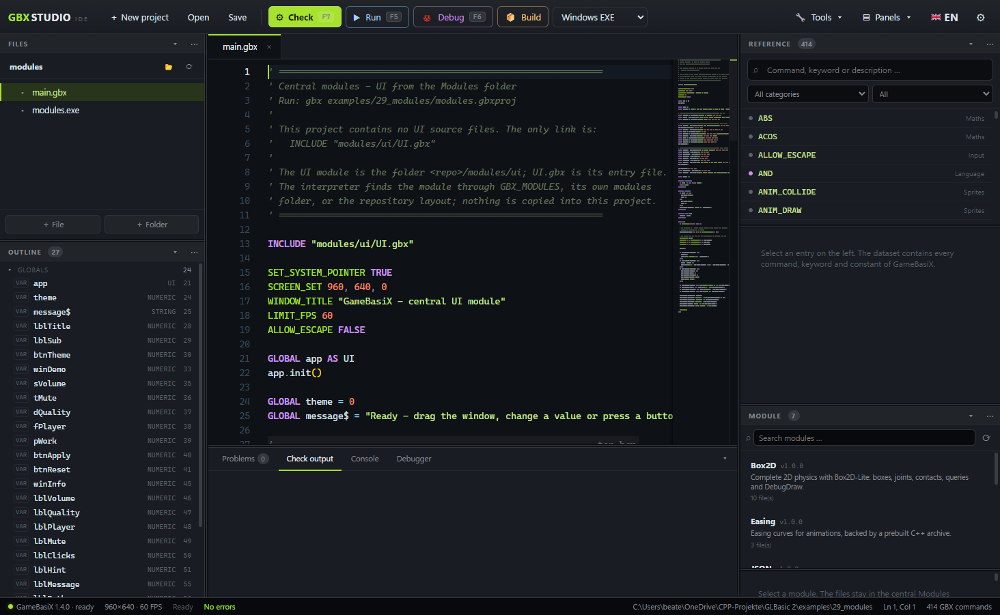
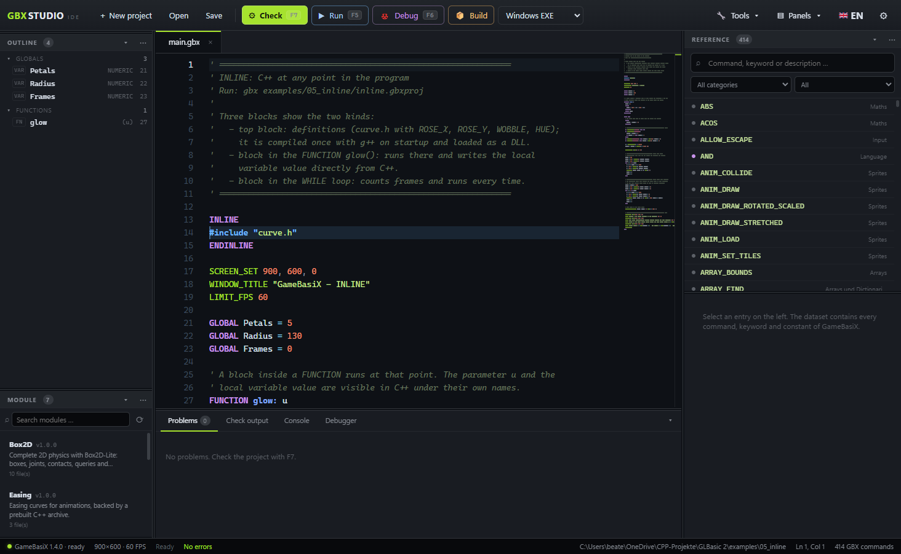
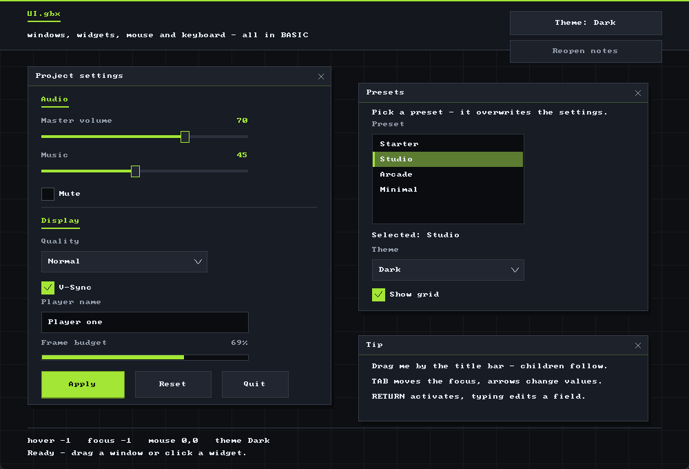
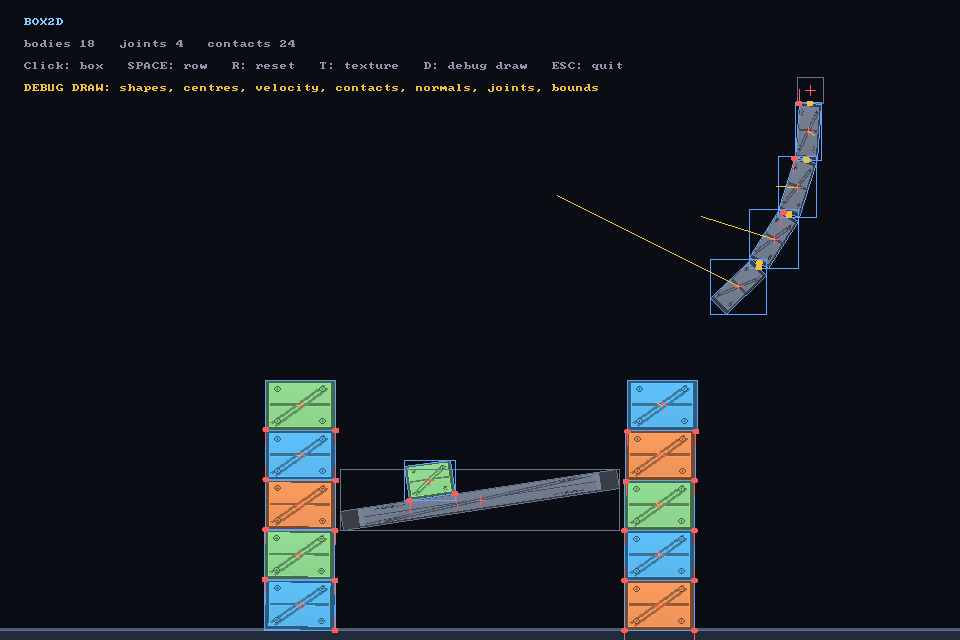
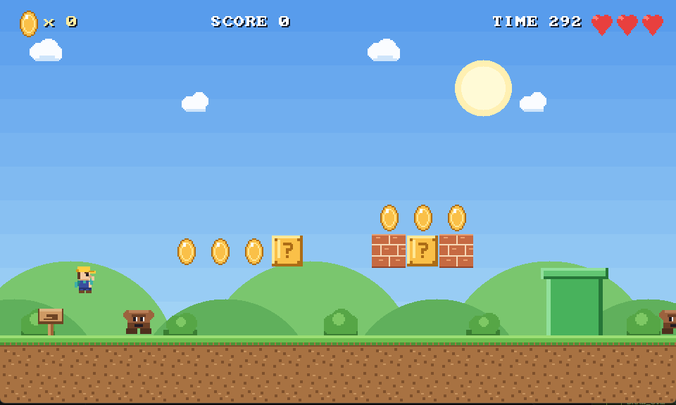
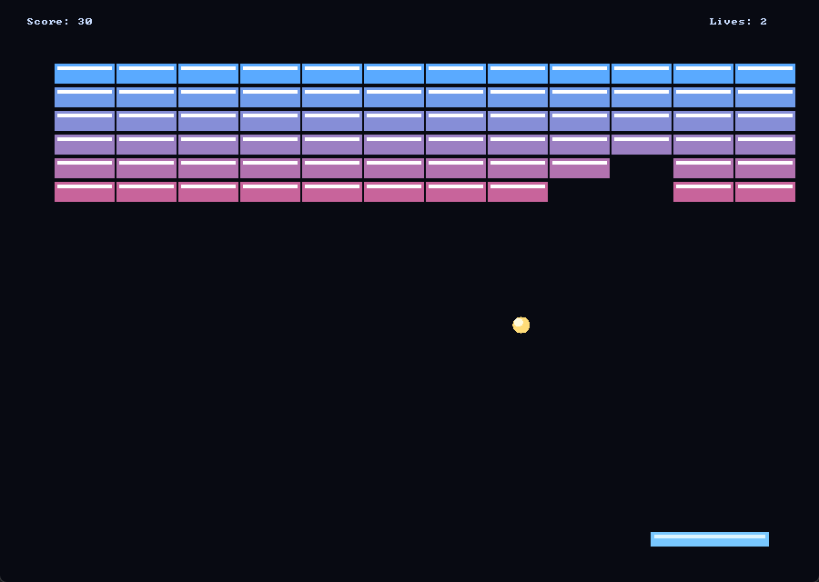
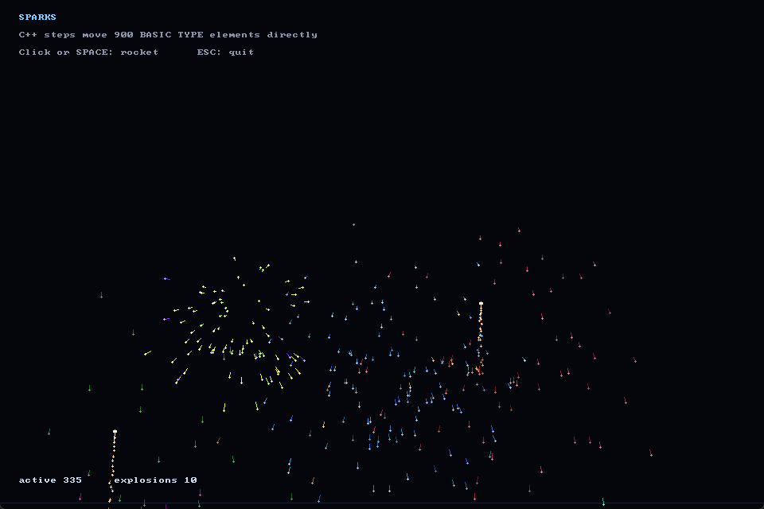
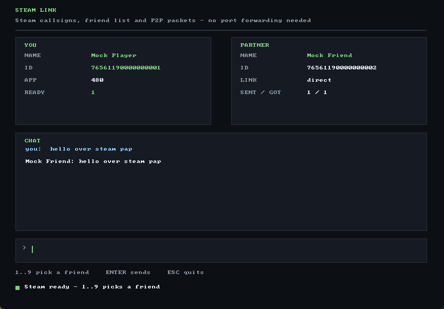

# GameBasiX


**GameBasiX is a native 2D game engine for Windows with its own BASIC interpreter.**
Write the game in readable BASIC, drop into C++ exactly where speed or a native
library matters, and keep both languages in the same source file. GBX Studio
puts the editor, live checks, debugger and both export targets around it.

<p align="center">
  
</p>

<p align="center"><sub><b>GBX Studio</b> — the camera example, project files and outline on the left, the C++/BASIC editor in the middle, and the searchable command reference on the right.</sub></p>

## BASIC for the game. C++ where it matters.

`INLINE` is not a separate project, a build script or a foreign-function wrapper.
It is a block in the middle of the BASIC program:

```basic
INLINE
#include "curve.h"                 // definitions: compiled once at startup
ENDINLINE

FUNCTION glow: u
  value = 0
  INLINE
    value = (1.0 - u) * (1.0 - u); // sees the BASIC parameter u and local value
  ENDINLINE
  RETURN value
ENDFUNCTION

WHILE TRUE
  INLINE
    Frames = Frames + 1;            // a step: runs here on every frame
  ENDINLINE
  SCREEN_SHOW
WEND
```

At top level an `INLINE` block contains **definitions**: headers and functions
registered with `GBX_INLINE_FN("NAME", …)` become ordinary GBX commands. Inside
a `FUNCTION`, `SUB`, `METHOD`, `IF` or loop it is a **step** that runs at that
point and sees the BASIC variables of that scope. Steps can call GBX commands
directly (`PRINT`, `DRAW_LINE`, `DELTA_TIME`, …), resize BASIC arrays
(`list.push(42)`, `insert`, `remove`, `resize`), or hand a finished image to the
screen with `blitScreen`. Constants are read-only; user-defined BASIC functions
stay in BASIC.

Definitions are cached by a hash of the generated C++ and loaded as a DLL on
startup. Projects can also link ready-built `.a` archives through `[native]`.
When a game is exported, the compiled INLINE code is embedded in the EXE or in
the HTML5 player, so the player needs neither a compiler nor a separate DLL.
See [INLINE: C++ inside the BASIC program](#inline-c-inside-the-basic-program)
for the complete rules.

## What the engine can do

| Area | Built in |
| --- | --- |
| **Language and runtime** | C++17 AST interpreter; suffixes (`$`, `%`, `#`), `FUNCTION`/`SUB`, `TYPE` with methods and defaults, interfaces and inheritance, `ENUM`, multi-dimensional arrays, `SELECT`, `TRY`/`CATCH`/`FINALLY`, `OPTION STRICT`, `BYREF`, static locals, includes and name checking. |
| **2D rendering** | SDL3 renderer; PNG/JPG/BMP sprites and animation sheets, rotation, scaling, stretching, collision helpers, polygons, render targets, viewports, screen scaling, alpha modes, RGBA colours and a pan/zoom/rotate 2D camera. |
| **Text and fonts** | Built-in 8×8 bitmap font, bitmap fonts on a 16×8 grid, TrueType through FreeType, text measurement, coloured text and `INPUT` fields. |
| **Audio** | Software mixer for WAV and MP3 sounds and music; pan, volume, loops and playback state. MP3 decoding uses the bundled minimp3. |
| **Input** | Keyboard scancodes with `KEY_*` names, mouse position/buttons/wheel, single-frame presses and connected gamepads with named buttons and axes. |
| **Data** | Buffered text and binary file I/O, directories, string/math helpers, arrays with sort/find, string-keyed dictionaries, `TYPE` arrays and arrays inside `TYPE`s. |
| **Networking** | Non-blocking TCP and UDP; listen/accept/connect, text packets, peer address, pending bytes and error text. |
| **Steam** | Friends and P2P packets, achievements, integer/float stats, leaderboards, cloud files, lobbies with member data, rich presence, overlay, auth session tickets and DLC checks. Loaded at runtime; the Steam DLL is not redistributed. |
| **Tasks and async work** | `TASK`/`AWAIT FRAME`/`AWAIT seconds` cooperative fibers, `SPAWN(@function, …)` worker jobs, `FILE_READ_ASYNC`/`FILE_WRITE_ASYNC`, and `JOB_DONE`/`JOB_VALUE` polling without blocking the frame. |
| **Native C++** | `INLINE` definitions and steps, direct access to BASIC variables and arrays, direct GBX calls, `[native]` archives/object files, generated C++ export and HTML5/Wasm support through Emscripten. |
| **Tools and shipping** | GBX Studio, live name/arity checking, debugger, hot reload for assets, one-file Windows EXE export and self-contained HTML5 export. |
| **Scope** | Deliberately 2D. There is no 3D renderer, scene graph or platform-specific editor layer; the 2D core is the product. |

The built-in command set covers **300+ commands**; the IDE ships **478 searchable
reference entries** including commands, keywords, operators, types and `KEY_*`
constants. The complete list is in the [command reference](#command-reference),
in [CHEATSHEET.png](CHEATSHEET.png), or in the IDE's reference panel.

## GBX Studio: what makes it different

GBX Studio is not a generic text editor with a syntax file bolted on. It knows
the project, the interpreter and the C++ blocks:

- **Two languages, one editor.** Monaco highlights GBX and switches to its C++
  tokenizer between `INLINE` and `ENDINLINE`; `.h` and `.cpp` files open as C++.
  User TYPEs, functions, constants, ENUM values and names registered with
  `GBX_INLINE_FN` get their own colours, completion and hover information.
- **Checks while you type.** Half a second after the last keystroke the unsaved
  buffer goes through `gbx --check --stdin`: syntax, unknown names, argument
  counts and TYPE fields become markers in the gutter and entries under
  **Problems**. No temporary files, no save required.
- **The reference is part of the workspace.** All 478 entries have signatures
  and descriptions in English and German, plus sample code where the command
  has one. Search, filter by category, read the detail pane, then **Insert** or
  **Copy** the signature without leaving the code.
- **Navigation that understands the language.** `F12` goes to a definition,
  `Shift+F12` lists every use and `F2` renames a symbol across the project.
  Scope matters: a field is searched in its TYPE and behind `obj.field`, a
  local only in its routine; comments, strings and INLINE blocks are skipped.
- **A debugger attached to the interpreter.** Breakpoints (also conditional),
  pause while running, step in/over/out, locals, globals, call stack and
  current values in a hover tooltip. The paused file opens automatically, even
  when the breakpoint is in an included file.
- **Run, check, build.** `F5` runs, `F7` checks, `F6` debugs and `Ctrl+E` builds
  the selected target: a Windows EXE (assets next to it) or a self-contained
  HTML5 folder.
  Saving an image, font or sound hot-reloads it into the running game.
- **A workspace that stays put.** Files, outline, reference, problems, output,
  console and debugger dock where you want them; widths and arrangement are
  stored per project. Dark and light themes, media previews, project templates
  and Google Fonts download are built in.

### INLINE, up close

<p align="center">
  
</p>

<p align="center"><sub><b>BASIC and C++ in one file</b> — the C++ block is highlighted as C++, the reference explains both kinds of INLINE block, and the project outline still sees the BASIC function and globals.</sub></p>

## See it running

| | |
|:--:|:--:|
|  |  |
| **UI toolkit** — windows, widgets and themes in pure BASIC (`examples/09_ui`) | **Physics** — boxes, joints and DebugDraw with the `BOX2D` module (`examples/08_box2d`) |
|  |  |
| **Pip and the Golden Coins** — tiles, enemies and sound (`examples/13_platformer`) | **Breakout** — a complete game (`examples/02_breakout`) |
|  |  |
| **900 sparks** — C++ steps moving a `TYPE` array (`examples/06_sparks`) | **Steam link** — friends and P2P packets (`examples/12_steam`) |

The newest examples are [`examples/27_tasks`](examples/27_tasks) (tasks,
worker jobs and async files), [`examples/28_camera`](examples/28_camera)
(pan, zoom, rotation and screen/world conversion),
[`examples/29_modules`](examples/29_modules) (the central UI module, with no
module files inside the project), [`examples/30_opengl3d`](examples/30_opengl3d)
(a 3D scene through the central OpenGL module) and
[`examples/31_easing`](examples/31_easing) (animation curves from a module that
ships a prebuilt C++ archive) and [`examples/32_json`](examples/32_json) (JSON
config and save data with path-based reads and writes).

## Quick start

**Use the portable build.** Download the latest
[Windows x64 release](https://github.com/SliverLIVE/GameBasiX/releases/latest),
unzip it and double-click **`GBXStudio.exe`**. Nothing has to be installed: the
package contains Electron, the interpreter, the bundled GCC for INLINE and the
HTML5 player. `GBXStudio_web.exe` opens the same editor in a browser instead.

**Build from source** (Windows, MSYS2 UCRT64, CMake and Ninja):

```bash
cmake -S . -B build -G Ninja -DCMAKE_BUILD_TYPE=Release
cmake --build build
build/gbx.exe examples/28_camera/camera.gbxproj
```

The build creates `build/gbx.exe`, `GBXStudio.exe` and `GBXStudio_web.exe`.
The version is read from `ide/package.json`; the detailed build options,
static-runtime packaging, project format and export notes follow below.

## Documentation

- [Building](#building) — requirements, static runtime and the portable layout
- [Running](#running) — CLI options and exit codes
- [Project file format](#project-file-format) — `.gbxproj`, includes and native libraries
- [The language at a glance](#the-language-at-a-glance) — types, arrays, methods and control flow
- [Command reference](#command-reference) — every built-in command by category
- [INLINE: C++ inside the BASIC program](#inline-c-inside-the-basic-program) — definitions, steps and limits
- [Tasks, jobs and async files](#tasks-jobs-and-async-files) — fibers and worker jobs
- [GBX Studio](ide/README.md) — editor, debugger, HTML5 export and IDE tests
- [CHEATSHEET.html](CHEATSHEET.html) / [CHEATSHEET.png](CHEATSHEET.png) — the one-page command sheet
- [Module cheat sheet](modules/CHEATSHEET.html) — the seven central modules at a glance

## Status

Version **1.4.0** is the current release. The C++ suite passes **17 of 17**
CTest targets, including language, INLINE, UI, files, networking, rendering,
commands, export, native libraries, Steam, lint, debugger and hot reload. The
IDE suite passes with the rebuilt command dataset. The project is deliberately
focused on Windows desktop and browser play; 3D and console platforms are out
of scope.

## Building

Requirements (Windows, MSYS2 UCRT64): `g++`, `cmake`, `ninja`, and internet
access during the first configure (SDL3 is fetched with `FetchContent`).

```bash
cmake -S . -B build -G Ninja -DCMAKE_BUILD_TYPE=Release
cmake --build build
```

Result: `build/gbx.exe`, `GBXStudio.exe` and `GBXStudio_web.exe` in the project
folder. The two small launchers open the editor from `ide/` on double click:
`GBXStudio.exe` in the Electron window, `GBXStudio_web.exe` always in the
browser (see [IDE](#ide)).

The version lives in one place: CMake reads `version` from `ide/package.json`
and passes it to `gbx.exe` (`--version`, the status bar of the editor) and to
the file properties of both launchers. Bumping it there is enough for the next
build; only the lockfile keeps its own copy.

TTF fonts are included through FreeType when it is found
(MSYS2: `pacman -S mingw-w64-ucrt-x86_64-freetype`). Without FreeType
everything still builds, just without TTF:

```bash
cmake -S . -B build -G Ninja -DGBX_WITH_TTF=OFF
```

An already installed SDL3 can be used with `-DGBX_USE_SYSTEM_SDL=ON`.

For handing the build to someone else, `-DGBX_STATIC_RUNTIME=ON` links the
MinGW runtime and FreeType statically. `gbx.exe` and `GBXStudio.exe` then need
no `libstdc++-6.dll`, `libgcc_s_seh-1.dll`, `libwinpthread-1.dll` and no
`libfreetype-6.dll` – only Windows 10/11:

```bash
cmake -S . -B build-static -G Ninja -DCMAKE_BUILD_TYPE=Release -DGBX_STATIC_RUNTIME=ON
cmake --build build-static
```

## Running

```bash
build/gbx.exe examples/01_hello/hello.gbxproj   # start a project
build/gbx.exe examples/02_breakout/main.gbx     # a single source file
build/gbx.exe --headless tests/language_tests.gbx
build/gbx.exe --check main.gbx                 # parse and check names
```

All messages are in English: the help, syntax errors, runtime errors and the
name check. That keeps the examples and the IDE consistent, whatever the
system language is.

| Option | Effect |
| --- | --- |
| `--headless` | no window and no sound; graphics commands become no-ops |
| `--tests` | like `--headless`, counts `ASSERT`s and prints a summary |
| `--check` | parse and check names, run nothing |
| `--syntax-only` | like `--check`, but without name checks (for individual part files) |
| `--stdin` | read the source from standard input (only with `--check`) |
| `--base <dir>`, `--name <file>` | base folder for `INCLUDE` and the file name in messages with `--stdin` |
| `--inline-cpp <file>` | write the generated C++ of the `INLINE` blocks (the HTML5 export links it in with Emscripten) |
| `--debug` | runtime debugger over stdin/stdout (breakpoints, single steps, variables) |
| `--version`, `-h/--help` | version or help |

Exit codes: `0` ok, `1` failed asserts, `2` syntax/runtime error, `3` internal
error.

`--check` does not only verify the syntax, it also checks names: anything the
program never defines is an error. It reports unknown commands (`bla`),
functions (`x = NOPE(1)`), variables (`PRINT foo`), labels (`GOTO later`) and
subroutines (`GOSUB missing`). Everything the program assigns, declares, uses
as a parameter or gets built in is known – including definitions from
`INCLUDE` files. Output parameters such as `INPUT name$` create their variable
themselves. While executing, GBX stays lenient: a variable that was never
assigned keeps returning the default value there.

Argument counts are checked as well. A built-in command, `FUNCTION`, `SUB` or
`METHOD` called with too few or too many arguments is reported before the
program starts. Parameters with a default (`punct$ = "!"`) are optional; the
check also catches a call that supplies none of the required parameters.

Fields of TYPEs are checked as well: if the TYPE of a variable is known
(`LOCAL p AS POINT`, `DIM field[2] AS POINT`, parameter `p AS POINT`, also via
`q = p` and nested TYPEs), `p.x` has to be a field of that TYPE. `p.nam$`
then reports `Unknown field: nam (POINT) - did you mean name?`. If the TYPE is
not unambiguous – for example because the same name is declared differently in
two functions – the check stays silent instead of guessing.

## Project file format

Instead of `.gbas`, GBX uses two clearly separated files:

* **`.gbx`** – source text (UTF-8, one statement per line, `'` or `//` as comment)
* **`.gbxproj`** – project file in INI style: window, entry point, FPS, asset folder
  and optionally C++ libraries for the `INLINE` blocks

Example `hello.gbxproj`:

```ini
[project]
name = "Hello World"
main = "main.gbx"          ; entry point relative to the project file

[window]
title = "My game"
width = 800
height = 600
fullscreen = 0
resizable = 1
icon = "assets/icon.png"     ; window and taskbar icon (PNG, BMP or ICO)

[graphics]
fps = 60                   ; 0 = unlimited
vsync = 1

[audio]
enabled = 1
volume = 1.0

[assets]
root = "assets"            ; additional search path for images/sounds
```

Asset paths are searched in this order: project directory,
`project directory/assets`, current directory. TTF names without a path are
additionally looked up in `%WINDIR%\Fonts` (so `"arial.ttf"` works directly).

The `icon` entry in `[window]` sets the icon of the game window and the
taskbar (PNG, BMP or ICO; an ICO may contain several sizes, the largest one is
used). GBX Studio offers the same field under **Settings → Project** and copies
a file chosen outside the project into `assets/`. The HTML5 export uses the
icon as the favicon of its `index.html`. Without an entry the game window and
the web export use the GBX icon, and `gbx.exe` carries the same icon as a
Windows resource, so exported games show it in Explorer too.

A project can consist of several files: `INCLUDE "lib.gbx"` pulls in more
source at that place. The path is relative to the file that contains the
`INCLUDE`, so a file in a subfolder reaches its neighbours with
`"../core/lib.gbx"`. Included files may include further files to any depth, and
a file that is already part of the program is skipped - a diamond loads once.
Top-level code of an included file runs in include order; constants, `FUNCTION`s,
`SUB`s and `TYPE`s are shared by all files. A file that includes one that is
still being parsed is a cycle: the error names the chain
(`Cyclic INCLUDE: main.gbx -> a.gbx -> main.gbx`) instead of piling up duplicate
definitions. See
[`examples/14_includes`](#examples) for a console test of that.

### Foreign C++ libraries

A project that uses `INLINE` can link libraries that are already built –
`mylib.a` from another project, a helper object file, or an import library for
a DLL. The optional `[native]` section puts them into the `g++` call that
compiles the blocks:

```ini
[native]
libs = lib/mylib.a lib/native.a   ; archives (.a) and object files (.o)
libdirs = lib                     ; search folders, passed as -L
sources = native/my.cpp           ; the C++ behind the archives, for HTML5
flags = -lmy -DFOO=1              ; further flags for the call
```

* Values are separated by spaces, relative paths start at the project folder.
* The archives are placed **behind** the source file, because a linker only
  pulls an archive apart once it knows the need for it. From two archives on
  they are wrapped in `-Wl,--start-group … --end-group`, so mutual references
  between them resolve in any order.
* The flags go behind the source as well: `-D`/`-I` apply to all files anyway,
  a link flag like `-lmy` has to stand after the object that uses it.
* Archives have to match the toolchain that compiles the blocks (MinGW-w64 GCC
  for the Windows build; an MSVC `.lib` does not fit). The bundled compiler has
  only the C++ frontend, so build the archive from `.cpp` with `g++.exe -c`; a
  library from a real C compiler (`gcc`) needs `extern "C"` in the header,
  C++ symbols need no wrapper.
* A missing archive is reported with its path instead of a bare linker error.
* Size and time stamp of the archives are part of the cache key: rebuilding a
  `.a` compiles the blocks again instead of reusing the old DLL.
* `--check` starts no compiler, and `--export` bakes the archives into the
  embedded DLL – a shipped game still needs no compiler and no `.a`.
* For the browser the archives are useless: a `.a` holds x86 code, and
  `wasm-ld` cannot link it. `sources` names the `.cpp` files the archive was
  built from; the HTML5 export compiles them with Emscripten, keeps the
  `-D`/`-I` flags of `[native]` and ignores `-l`/`-L` with a note. On the
  desktop the archives are linked and `sources` stays unused. Without `sources`
  an export with INLINE and `libs` stops with that explanation instead of a
  wall of `undefined symbol` lines.

A header that registers commands from a library looks like any other `INLINE`
definition – it just calls into the archive:

```cpp
#include <gbx_inline.h>
#include "mylib.h"                     // declares my_add(int, int)

static void add(const GbxValue* args, int argc, GbxValue* ret) {
    gbxinline::retNum(ret, my_add(gbxinline::argNum(args, argc, 0), 2));
}
GBX_INLINE_FN("ADD2", 1, 1, add);
```

Keep the archive free of GBX types: `mylib.h` declares plain C++ and stays
usable from any program, a second header (`commands.h`) includes it plus
`gbx_inline.h` and holds the registrations. An `INLINE` step can then call
`my_add()` directly, without a registered command in between.

[`examples/15_library`](#examples) is the complete picture: two archives, one
named by path and one as `-l`, a `-D` flag that reaches the header, a self check
at startup, and `tests/library/lib_checks.gbxproj`, which checks the shipped
archives value by value in CTest.

## The language at a glance

```basic
' comment
CONSTANT WIDTH = 800

TYPE POINT
  x AS FLOAT
  y AS FLOAT
  lives% = 3                 ' default value per instance
ENDTYPE

GLOBAL points AS POINT

ENUM FACE                 ' 0, 1, then 10, 11
  IDLE
  RUN
  JUMP = 10
  FALL
ENDENUM

FUNCTION distance: a AS POINT, b AS POINT
  dx = b.x - a.x
  dy = b.y - a.y
  RETURN SQR(dx * dx + dy * dy)
ENDFUNCTION

DIM field[10]              ' indices 0..9
field[0] = 5
field[-1] = 7              ' last element

FOR i = 10 TO 1 STEP -2
  field[i / 2] = i
NEXT

SELECT field[0]
CASE 1, 2
  DEBUG "small" + CHR$(10)
CASE 3 TO 9
  DEBUG "medium" + CHR$(10)
DEFAULT
  DEBUG "large" + CHR$(10)
ENDSELECT
```

**Values and types.** Numbers are `FLOAT` by default, integers use `%`, strings
use `$`; `#` forces `FLOAT`. On assignment the suffix converts the value
(`x$ = 5` becomes `"5"`). `TRUE`/`FALSE` are `1`/`0`.

**Operators.** `+ - * /`, comparisons `= <> < <= > >=`, `AND`, `OR`, `NOT`.
`/` always yields a decimal number, `MOD(a,b)` the integer remainder.
`x += 1`, `x -= 1`, `x *= 2` and `x /= 2` write the result straight back to the
variable, to an array element or to a TYPE field; `+=` appends to strings too.

**Control flow.** `IF/THEN/ELSE/ELSEIF/ENDIF` (single-line as well), `FOR ... TO
... STEP`, `WHILE/WEND`, `REPEAT/UNTIL`, `SELECT/CASE/DEFAULT/ENDSELECT`,
`BREAK`, `CONTINUE`, `GOTO label:` inside one scope, `GOSUB sub`.

**ENUM.** `ENUM name … ENDENUM` groups named numbers: the first value is `0`,
each further value counts one up, and `= value` (also an expression) sets it
yourself. A value is always written with its ENUM in front – `STATE.RUN` – so
two ENUMs may offer the same short name:

```basic
ENUM STATE
  IDLE
  RUN
  PAUSE = 10
  OVER
ENDENUM

state% = STATE.IDLE

SELECT state%
CASE STATE.IDLE
  PRINT "ready", 0, 0
CASE STATE.RUN
  PRINT "running", 0, 0
ENDSELECT
```

A bare `RUN` is an error and names the full value: *Unknown name: RUN - did
you mean STATE.RUN?* The same hint appears when the value itself is misspelt
(`STATE.RNU`).

**Functions.** `FUNCTION name: p1, p2 = 0 … ENDFUNCTION` with `RETURN`, `EXIT`
for an early return, `STATIC` for persistent locals, `BYREF` for reference
parameters (also to array elements and TYPE fields). `SUB name: … ENDSUB` is a
parameterless procedure for `GOSUB`. The colon after the name is part of the
syntax and required, also without parameters: `FUNCTION name:` and `SUB name:`.
The same holds for `METHOD name:` inside a `TYPE`.

**Arrays.** `DIM a[10]`, up to 4 dimensions, `DIM a[10] AS TYPE`, `REDIM`
(keeps data; for TYPE arrays `REDIM a[10] AS TYPE`), `DIMPUSH`, `DIMDEL`,
`DIMDATA`, `ARRAY_BOUNDS(a[], dim)`, `LEN(a[])`, `FOREACH x IN a[] … NEXT`
(BYREF to the element). `GLOBAL a[10]`, `LOCAL a[10] AS TYPE` and `STATIC
a[10]` take the same brackets as `DIM` and only add the scope: inside a
function that is the short way to a local array, `GLOBAL` puts it in the whole
program and `STATIC` keeps it between calls (it is created once). Empty
brackets declare an open array: `GLOBAL items[] AS ITEM` starts with length 0
and grows with `DIMPUSH` (the same works for `LOCAL` and `STATIC`). A field of a
TYPE can be an array as well – see *Arrays inside a TYPE* below.

**TYPE.** Fields without a suffix are `FLOAT`, `$` makes strings, `AS
OtherType` nests. `LOCAL v AS TYPE`, `GLOBAL v AS TYPE`, `DIM arr[5] AS TYPE`.
Fields may carry a default value: `lives% = 3`, `name$ = "new"`, also
`total% = a + b` or a constant. The expression runs for every new instance –
for `LOCAL`, `GLOBAL` and every element of a TYPE array. `TYPE` values are
shared by reference (fields and arrays are pointers).

**Arrays inside a TYPE.** A field may itself be an array: `fixed[3] AS ITEM`, a
number array `coins[4]`, and `slots[] AS ITEM` for an empty one that grows with
`DIMPUSH`. The size expressions run per instance (a constant works too), so
every object owns its own arrays and two objects never share items. A field
array behaves like a plain array: `bag.fixed[1].name$`, `LEN(bag.slots)`,
`FOREACH s IN bag.slots[] … NEXT`, `DIMPUSH bag.slots[], value`, `DIM
bag.slots[8]` and `REDIM` (keeps the values that still fit) resize it in place.
A field array takes no default value (`fixed[3] = 1` is a parse error), and a
single value cannot replace it – assign to an element instead. `INLINE` steps
see the field as an array handle: `bag.slots.size()`, `bag.slots[0]`, and
`bag.slots.push(0.0)`.

```basic
TYPE ITEM
  name$ = "?"
  value% = 0
ENDTYPE

TYPE BAG
  fixed[3] AS ITEM     ' three items, created with the field defaults
  slots[] AS ITEM      ' empty at first, grows with DIMPUSH
ENDTYPE

GLOBAL bag AS BAG
bag.fixed[0].name$ = "torch"
DIMPUSH bag.slots[], 0
bag.slots[0].value% = 5
PRINT LEN(bag.fixed), 0, 0      ' 3
PRINT LEN(bag.slots), 0, 0      ' 1
```

**Methods.** A `TYPE` can carry `METHOD`s. They live in the TYPE block and are
called with `object.name(...)`:

```basic
TYPE BOX
  w AS FLOAT
  h AS FLOAT

  METHOD area:
    RETURN w * h
  ENDMETHOD

  METHOD scale: factor
    w = w * factor
    h = h * factor
  ENDMETHOD
ENDTYPE

LOCAL b AS BOX
b.w = 4
b.h = 2
PRINT b.area(), 0, 0     ' 8
b.scale(3)
PRINT b.w, 0, 0          ' 12
```

Inside the body the fields of the type itself are visible like variables;
assignments write straight into the object. `self` stands for the object
itself, so `self.x` and `self.area()` – handy for passing the object to
another function. Parameters and `LOCAL` shadow a field with the same name.
Method names written without an object count as `self.method(...)` – so
`scale(2)` calls the object's own method. Methods work on variables, TYPE
fields and elements of TYPE arrays. `FUNCTION` and `SUB` inside a `TYPE` are
rejected by the parser with a hint to use `METHOD`.

**Errors.** `TRY … CATCH err$ … FINALLY` catches runtime errors; `THROW "text"`
raises one yourself. Several `CATCH` blocks may follow, each with an optional
`WHEN` condition that sees the message in `err$`; a `CATCH` without `WHEN`
catches everything. `FINALLY` takes its own block that always runs – after the
block, after a caught error and while an error travels on – and `ENDTRY`
closes the whole statement. The old form without a `FINALLY` body still parses.

```basic
TRY
  risky()
CATCH e$ WHEN INSTR(e$, "file") >= 0
  DEBUG "missing file" + CHR$(10)
CATCH e$
  THROW e$               ' not ours: pass it on
FINALLY
  busy = FALSE            ' runs in every case
ENDTRY
```

**Sorting and searching.** `ARRAY_SORT array[, direction[, field$]]` sorts an
array in place and returns its length; `direction` is `1` (default, ascending)
or `-1`. Numbers sort numerically, text alphabetically, and for an array of
TYPEs `field$` names the field to compare. `ARRAY_FIND(array, value[, start])`
returns the first matching index or `-1`.

```basic
DIM scores[5]
…
ARRAY_SORT scores, -1             ' highest first
rank = ARRAY_FIND(scores, 42)     ' -1 when missing
ARRAY_SORT players, 1, "score"    ' TYPE array, by field
```

**Dictionaries.** `DICT_NEW()` makes an empty dictionary – keys are text, the
values are anything. Like an array it is a reference, so handing it to a
function hands over the same table.

| Command | Meaning |
| --- | --- |
| `DICT_SET d, key$, value` | store (overwrites), returns `d` |
| `DICT_GET(d, key$[, default])` | value, `default` (or `0`) when missing |
| `DICT_HAS(d, key$)` · `DICT_DELETE d, key$` | test / remove (`1` when it was there) |
| `DICT_COUNT(d)` · `LEN(d)` | number of entries |
| `DICT_KEY$(d, i)` · `DICT_VALUE(d, i)` | entry by position, in insertion order |
| `DICT_KEYS(d)` · `DICT_VALUES(d)` | the entries as an array |
| `DICT_CLEAR d` | remove everything |

**Function values.** `@name` is a reference to a `FUNCTION`. It can be passed
as an argument, stored in a variable or an array element, and called through
that name:

```basic
FUNCTION twice: x
  RETURN x * 2
ENDFUNCTION

FUNCTION apply: f, value
  RETURN f(value)
ENDFUNCTION

PRINT apply(@twice, 21), 0, 0     ' 42
```

`ISA(@twice, "function")` answers `1`.

**Inheritance and interfaces.** `TYPE B EXTENDS A` takes over every field and
every method of `A` – the field defaults included – and may add its own fields
and override methods. `ISA(obj, "A")` tells whether the object is an `A` or
derived from one. An `INTERFACE` names the methods a type has to offer, and
`IMPLEMENTS` checks that while parsing:

```basic
INTERFACE DRAWN
  SUB draw: x, y
ENDINTERFACE

TYPE SHAPE
  x AS FLOAT
  y AS FLOAT

  METHOD draw: px, py
    x = px
    y = py
  ENDMETHOD
ENDTYPE

TYPE CIRCLE EXTENDS SHAPE IMPLEMENTS DRAWN
  r AS FLOAT
ENDTYPE
```

A `TYPE` that misses a method of a named interface is a parse error, and so is
an unknown base type or a cycle (`A EXTENDS B`, `B EXTENDS A`).

**Strict mode.** `OPTION STRICT` at the top of a program (or `--strict` on the
command line) turns a variable that was never assigned into a runtime error
instead of silently reading `0`/`""`. Assigning to a name still creates it.

## Command reference

A one-page summary of every command, grouped by command type, is in
[CHEATSHEET.png](CHEATSHEET.png), generated by
[`python tools/make_cheatsheet.py`](tools/make_cheatsheet.py) from the IDE's
command dataset.

Commands marked with `*` are additions that go beyond the basic language.

**Window and screen**
`SCREEN_SET w,h,fullscreen` · `SCREEN_CLEAR [color]` (`-1` turns off automatic
clearing) · `SCREEN_BLACK` · `SCREEN_SHOW` · `LIMIT_FPS fps[,vsync]` ·
`SCREEN_SIZE w,h` · `DESKTOP_SIZE w,h` · `SCREEN_FULLSCREEN()` ·
`WINDOW_TITLE "text"`* · `SCREEN_WIDTH()`* · `SCREEN_HEIGHT()`* ·
`SET_VIEWPORT x,y,w,h` · `VIEWPORT x,y,w,h` · `SCREEN_SCALE w,h` ·
`CAMERA_BEGIN x,y[,zoom[,angle]]` · `CAMERA_END` ·
`CAMERA_SCREEN_TO_WORLD x,y,wx,wy` · `CAMERA_WORLD_TO_SCREEN x,y,sx,sy` ·
`SET_SMOOTHING on` · `SET_ALPHA_MODE a` · `SET_ALPHA_TEST value` ·
`SET_COLOR_KEY color`

**Drawing**
`RGB(r,g,b[,a])` · `DRAW_LINE x1,y1,x2,y2,color` · `DRAW_RECT x,y,w,h,color` (filled) ·
`DRAW_RECT_BORDER x,y,w,h,color`* · `DRAW_CIRCLE x,y,r[,color]`* ·
`DRAW_CIRCLE_FILLED x,y,r[,color]`* · `PIXEL_SET x,y,color` · `PIXEL_GET(x,y)` ·
`POLY_BEGIN sprite,mode` · `POLY_POINT x,y,u,v,color` (u/v 0…1) · `POLY_STRIP` ·
`POLY_END`

**Sprites**
`SPRITE_LOAD "image.png", id` · `SPRITE_NEW()` · `SPRITE_DRAW id,x,y` ·
`SPRITE_DRAW_ROTATED id,x,y,angle` · `SPRITE_DRAW_ROTATED_SCALED id,x,y,angle,zoom%` ·
`SPRITE_DRAW_SCALED id,x,y,fx%,fy%` · `SPRITE_DRAW_STRETCHED id,x,y,w,h` ·
`ANIM_LOAD "sheet.png",id,tilew,tileh` · `ANIM_SET_TILES id,w,h` ·
`ANIM_DRAW id,frame,x,y` · `ANIM_DRAW_ROTATED_SCALED id,frame,x,y,angle,zoom%` ·
`ANIM_DRAW_STRETCHED id,frame,x,y,w,h` · `SPRITE_SIZE id,w,h` ·
`SPRITE_GRAB id,x,y,w,h` · `SPRITE_SAVE "file.png",id` ·
`SPRITE_COLLIDE(id1,x1,y1,id2,x2,y2)` · `ANIM_COLLIDE(...)` · `RECT_COLLIDE(x1,y1,w1,h1,x2,y2,w2,h2)`

**Image buffer and text**
`BACKGROUND_LOAD "image.png"` (background) · `SCREEN_SAVE_BMP "file.bmp"` · `SCREEN_TO_BACKGROUND` ·
`SCREEN_FADE "image.png"[,ms]` · `SCREEN_CREATE screen,sprite,w,h` ·
`SCREEN_USE id` · `PRINT "text",x,y[,kerning]` · `TEXT_DRAW "text",x,y[,color]`* ·
`TEXT_COLOR color`* · `TEXT_WIDTH(text)`* → width in pixels ·
`TEXT_HEIGHT(text)`* → height of all lines · `FONT_LOAD "file",id[,size]` ·
`FONT_SET id[,scale[,color]]` · `FONT_SIZE w,h` · `FONT_CURRENT()` ·
`INPUT var,x,y` · `LEN(text[,pixels])`

**Input**
`KEY_DOWN(scancode)` · `KEY_PRESSED(scancode)`* · `INKEY$` · `MOUSE_STATE mx,my,left,right` ·
`MOUSE_AXIS(axis)` · `MOUSE_PRESSED(button)`* · `MOUSE_COUNT()` ·
`MOUSE_MOVE x,y` · `MOUSE_WAIT` · `KEY_WAIT` ·
`SET_SYSTEM_POINTER on` · `ALLOW_ESCAPE on` ·
`JOY_COUNT()`* → connected gamepads · `JOY_AXIS(pad,axis)`* ·
`JOY_BUTTON(pad,button)`* (held) · `JOY_PRESSED(pad,button)`* (this frame)

Ready-made key codes: `KEY_ESC`, `KEY_ENTER`, `KEY_SPACE`, `KEY_TAB`,
`KEY_BACKSPACE`, `KEY_DELETE`, `KEY_HOME`, `KEY_END`, `KEY_PGUP`, `KEY_PGDN`,
`KEY_UP/DOWN/LEFT/RIGHT`, `KEY_LSHIFT/RSHIFT`, `KEY_LCTRL/RCTRL`,
`KEY_LALT/RALT`, `KEY_F1`…`KEY_F12`, `KEY_A`…`KEY_Z`, `KEY_0`…`KEY_9`.

Ready-made gamepad names, so the numbers need no lookup: `JOY_A`, `JOY_B`,
`JOY_X`, `JOY_Y` (the four face buttons, named by position), `JOY_BACK`,
`JOY_GUIDE`, `JOY_START`, `JOY_LSTICK`, `JOY_RSTICK`, `JOY_LB`, `JOY_RB`,
`JOY_UP/DOWN/LEFT/RIGHT` (D-pad), and for `JOY_AXIS` the axes `JOY_AXIS_LX`,
`JOY_AXIS_LY`, `JOY_AXIS_RX`, `JOY_AXIS_RY`, `JOY_AXIS_LT`, `JOY_AXIS_RT`.

**Sound**
`SOUND_LOAD "sound.wav",id[,buffer]` · `SOUND_PLAY(id,pan,volume)` → channel ·
`SOUND_STOP channel` · `SOUND_PLAYING(channel)` · `SOUND_STOP_ALL` · `SOUND_NEW()` ·
`MUSIC_PLAY "music.mp3",loop` · `MUSIC_STOP` · `MUSIC_PAUSE on` ·
`MUSIC_VOLUME v` · `MUSIC_PLAYING()`

Both commands take `.wav` and `.mp3`; a file whose format is neither is
reported by name instead of playing silence.

**Math**
`ABS` · `SGN` · `SQR` · `SIN` · `COS` · `TAN` (degrees) · `ASIN` · `ACOS` ·
`ATAN(dy,dx)` (degrees) · `FLOOR` · `CEIL` · `POW(a,b)` · `LOGN` ·
`MOD(a,b)` · `FMOD(a,b)` · `MIN` · `MAX` · `RND(max)` (0…max, inclusive) ·
`RND_SEED n` · `INTEGER` · `INTEGER64` · `NUMBER` · `SHL` · `SHR` ·
`BAND` · `BOR` · `BXOR` · `BNOT` · `IIF(condition, a, b)`

**Strings**
`LEN` · `LEFT$` · `RIGHT$` · `MID$(text,start[,length])` (0-based) ·
`INSTR(text,search[,start])` (0-based, `-1` = not found) · `INSTR_REVERSE` ·
`REPLACE$` · `SPLIT_STRING(text, array$[], separator[, empty])` ·
`JOIN$(array$[], separator[, start[, count]])` · `UCASE$` · `LCASE$` ·
`TRIM$` · `LTRIM$` · `RTRIM$` · `ASC(text[,index])` · `CHR$` · `HEX$` ·
`FORMAT$(places,decimals,number)` · `FORMAT$("text {0}", value)` (template) ·
`STR$`* · `VAL`*

**Files**
`FILE_OPEN channel, file, mode` · `FILE_CLOSE channel` ·
`FILE_SEEK channel, offset, origin` · `FILE_POSITION(channel)` · `FILE_EOF(channel)` ·
`FILE_READ_BYTE channel, var%` · `FILE_READ_UBYTE channel, var%` · `FILE_READ_WORD channel, var%` ·
`FILE_READ_UWORD channel, var%` · `FILE_READ_LONG channel, var%` · `FILE_READ_ULONG channel, var%` ·
`FILE_READ_DOUBLE channel, var#` · `FILE_READ_FLOAT channel, var#` ·
`FILE_READ_STR channel, text$, count` · `FILE_READ_LINE channel, text$` ·
`FILE_WRITE_BYTE channel, value` · `FILE_WRITE_UBYTE channel, value` ·
`FILE_WRITE_WORD channel, value` · `FILE_WRITE_UWORD channel, value` ·
`FILE_WRITE_LONG channel, value` · `FILE_WRITE_ULONG channel, value` ·
`FILE_WRITE_DOUBLE channel, value#` · `FILE_WRITE_FLOAT channel, value#` ·
`FILE_WRITE_STR channel, text$` · `FILE_WRITE_LINE channel, text$` ·
`FILE_EXISTS(path)` · `FILE_SIZE(path)` · `FILE_COPY source, target` ·
`FILE_RENAME source, target` · `FILE_DELETE path` · `DIR_MAKE path`

**Arrays and dictionaries**
`ARRAY_SORT array[, direction[, field$]]` · `ARRAY_FIND(array, value[, start])` ·
`DICT_NEW()` · `DICT_SET d,key$,value` · `DICT_GET(d,key$[,default])` ·
`DICT_HAS(d,key$)` · `DICT_DELETE d,key$` · `DICT_COUNT(d)` · `DICT_KEY$(d,i)` ·
`DICT_VALUE(d,i)` · `DICT_KEYS(d)` · `DICT_VALUES(d)` · `DICT_CLEAR d` ·
`ISA(value, "TYPE")`

**Network**
`NET_LISTEN port` · `NET_ACCEPT listener` · `NET_CONNECT host,port[,timeout]` ·
`NET_SEND handle,text` · `NET_RECV$(handle)` · `NET_PENDING(handle)` ·
`NET_CONNECTED(handle)` · `NET_PEER$(handle)` · `NET_PORT(handle)` · `NET_IP$` ·
`NET_CLOSE handle` · `NET_ERROR$` · `UDP_OPEN port` ·
`UDP_SEND handle,host,port,text` · `UDP_RECV$(handle)` · `UDP_FROM$(handle)` ·
`UDP_PORT(handle)` · `UDP_CLOSE handle`

**Steam** (module)
Steam is the module `modules/steam` and no longer part of the
interpreter: add `INCLUDE "modules/steam/STEAM.gbx"` once and put the
Steamworks library (`steam_api64.dll`) next to the EXE.
`modules/steam/HELP.md` has the complete `STEAM_*` reference and the
download link for the SDK.

**Tasks and jobs**
`TASK_START("name")` → id · `TASK_STOP(id)` · `TASK_RUNNING(id)` · `TASK_COUNT()` ·
`SPAWN(@function, args…)` → job · `JOB_DONE(job)` · `JOB_VALUE(job)` ·
`JOB_ERROR$(job)` · `JOB_FREE(job)` · `FILE_READ_ASYNC(path)` → job ·
`FILE_WRITE_ASYNC path, text` → job

**Runtime and debug**
`DEBUG` · `STDOUT` · `STDERR` · `STDIN$` · `SLEEP ms` · `DELTA_TIME()` ·
`ELAPSED_TIME()` · `COMMAND_LINE$()` · `SOURCE_LINE()` · `SOURCE_FILE$()` ·
`PLATFORM_INFO$("os")` · `ENV$` · `SET_ENV` · `ASSERT condition[,text]` ·
`ASSET_RELOAD()` · `HOT_RELOAD value` (`0` stops the watching, `1` resumes it) · `HOT_RELOAD_ON()` · `END` · `WAIT_INPUT`

## Language details

* **Case**: commands, keywords and built-in type names ignore the spelling
  (`PRINT`, `print` and `Dim` all work). Names you define yourself are
  case-sensitive: variables, `FUNCTION`/`SUB`/`METHOD`, `TYPE`, `INTERFACE`,
  `ENUM` and their values. `MyVar` and `myvar` are two different variables, and
  `TYPE Circle` does not fit `DIM c AS CIRCLE`. A type suffix (`$`, `%`, `#`)
  is part of the name.
* **Key codes**: `KEY_DOWN()`/`KEY_PRESSED()` take SDL3 scancodes; the `KEY_*` constants
  save you the lookup.
* **Gamepads**: `JOY_COUNT()` is the number of connected pads, `pad` is `0` up to
  that minus one. `JOY_AXIS` returns a stick in `-1…1` (up and left negative)
  and a trigger in `0…1`; a dead zone around zero is the game's own choice
  (`IF ABS(JOY_AXIS(0, JOY_AXIS_LX)) > 0.2`). `JOY_BUTTON` is the held state like
  `KEY_DOWN`, `JOY_PRESSED` is the single frame the button went down like
  `KEY_PRESSED`. Pads connected while the game runs are picked up, removing one
  simply makes its index unavailable; without a pad every query answers `0`.
* **Text sizes**: `TEXT_WIDTH` returns the width of the longest line in pixels,
  `TEXT_HEIGHT` the height of all lines together – both for the font set with
  `FONT_SET`, so a window can place text it has not drawn yet. `LEN(text, TRUE)`
  is the older spelling for the width and still works.
* **Formats**: `MID$`, `ASC` and `INSTR` are 0-based and `RND(max)` is
  inclusive. `SIN/COS/TAN` and `ATAN` work in degrees.
* **Arrays**: `DIM a[n]` gives the indices `0…n-1`, negative indices count from
  the end, `DIM a[0]` frees the memory. `GLOBAL a[n]`, `LOCAL a[n]` and
  `STATIC a[n]` build the array in that scope instead – a `LOCAL a[n]` inside a
  function hides a global array of the same name, a `GLOBAL a[n]` in a function
  is visible everywhere afterwards.
* **Several dimensions**: every value in the brackets is one dimension, so
  `DIM map[w, h]` builds a table and `map[x, y]` reads the cell at column `x`,
  row `y`. `map[x][y]` is the same cell, `DIM map[w][h]` the same table. How
  many dimensions an array has is up to the program – `DIM world[w, h, 4]`
  works as well; the limit is the memory, one array may hold up to 100 million
  cells. `LEN(map)` is the first dimension, `LEN(map[x])` the next one,
  `REDIM` keeps the cells that still fit, and `FOREACH row IN map[]` walks the
  rows. A TYPE field may have several dimensions too (`tiles[w, h] AS TILE`,
  resized with `DIM bag.tiles[…]` and `REDIM`). A row is an array itself, so a
  single value cannot replace it – writing `map[x] = 5` is an error that names
  `[x, y]` as the way in.
* **Function headers**: `FUNCTION`, `SUB` and `METHOD` always take a colon
  after the name, also without parameters: `FUNCTION draw:`, `SUB reset:`,
  `METHOD clear:`. A missing colon is a syntax error with the line number.
* **GOTO/GOSUB**: `GOTO` only jumps inside the current scope (main program,
  `SUB` or `FUNCTION`) and only to labels on its top level. `GOSUB` calls
  `SUB`s; there are no return labels.
* **TRY/CATCH**: `FINALLY` opens a block that always runs, and `ENDTRY` closes
  the whole statement. The old form without a `FINALLY` body still parses.
* **ENUM**: `ENDENUM` closes the block; a value is addressed as `ENUM.VALUE`
  (`STATE.RUN`), so several ENUMs may use the same short name. The bare name is
  not defined – `--check` reports it with *Unknown name: RUN - did you mean
  STATE.RUN?*. Without `=`
  the first value is `0` and every further one is the previous value plus one –
  also after an explicit value (`JUMP = 10`, `FALL` becomes `11`). ENUM members
  are integers even when the expression yields a decimal number.
* **Compound assignment**: `+=`, `-=`, `*=` and `/=` read the target once, apply
  the operator and write the result back. `/=` uses the normal division, so
  `x% /= 2` rounds by truncation when it stores back into the integer.
* **`JOIN$`/`FORMAT$`**: `JOIN$` is the counterpart of `SPLIT_STRING` and also
  joins number arrays. `FORMAT$` takes either the numeric form (width, decimals,
  number) or a template as its first argument; a placeholder without an
  argument is an error, extra arguments are ignored.
* **Audio**: WAV and MP3, both through the same mixer – MP3 is decoded to the
  same float samples while loading, so `SOUND_*` and `MUSIC_*` accept either
  format. Other formats (OGG, FLAC, M4A) have no decoder and are reported as
  unrecognised.
* **Fonts**: `FONT_LOAD` loads `.bmp` fonts on a grid with 16 characters per
  row and 8 rows (characters 0–127) or – for `.ttf`/`.otf` or when a size is
  given – a TrueType font through FreeType. `FONT_SET id,scale` scales it.
  The kerning parameter of `PRINT` is ignored (bitmap fonts are monospaced).
* **SET_ALPHA_MODE** is approximate: `> 0` additive, `< 0` alpha `1+value`,
  `0` normal. A fourth `RGB` argument sets opacity per colour (0 transparent
  to 255 opaque); it is combined with the global alpha mode.
* **`SET_ALPHA_TEST`/`SET_COLOR_KEY`** apply while loading images, not
  retroactively to sprites that are already loaded.
* **`SCREEN_SAVE_BMP`/`SPRITE_GRAB`** need a real renderer; in `--headless` mode they
  report an error.
* **SCREEN_SCALE** uses SDL logical presentation; `SET_VIEWPORT` is then in window
  coordinates.
* **CAMERA_BEGIN** switches drawing to a 2D world camera. `x,y` is the world
  point in the centre of the current viewport, `zoom` defaults to 1 and
  `angle` defaults to 0 (degrees, counter-clockwise, like
  `SPRITE_DRAW_ROTATED`). Draw the world between `CAMERA_BEGIN` and
  `CAMERA_END`; draw the HUD after `CAMERA_END`. `CAMERA_SCREEN_TO_WORLD` and
  `CAMERA_WORLD_TO_SCREEN` convert coordinates for mouse input and overlays.
  A camera is closed automatically at the next `SCREEN_SHOW` if `CAMERA_END`
  is missing. [`examples/28_camera`](examples/28_camera) is a complete demo
  with a free camera, a fixed HUD and both coordinate conversions.
* **`INLINE`** compiles the C++ blocks with `g++` (the package ships one):
  definitions are loaded as a DLL at startup, steps run in the middle of the
  code (see [INLINE](#inline-c-inside-the-basic-program)). Prebuilt libraries
  come from the `[native]` section of the project file
  ([Foreign C++ libraries](#foreign-c-libraries)). There is no `IMPORT` or
  `REQUIRE`.
* **Network**: sockets never block. `NET_ACCEPT`, `NET_RECV$`, `UDP_RECV$` and
  `NET_PENDING` return immediately; only `NET_CONNECT` waits, at most for its
  timeout (default 3000 ms). Handles are positive integers and shared by TCP
  and UDP.
* **Browser**: the HTML5 player has no raw sockets, so the `NET*`/`UDP*`
  commands report an error there; Steam is desktop-only as well.

## Files and folders

`FILE_OPEN channel, file, mode` opens a file and binds it to a channel (a
positive integer): mode `1` reads, `0` writes a new file, `-1` appends. The
call returns `1` on success and `0` otherwise, for example when the file is
missing. `FILE_CLOSE channel` closes it and flushes the data.

Reading and writing are binary and little-endian: `BYTE` (1 byte), `WORD`
(2), `LONG` (4), `SHORTIEEE` (4-byte float) and `IEEE` (8-byte double), with
unsigned variants `FILE_READ_UBYTE`, `FILE_READ_UWORD` and `FILE_READ_ULONG` for values that
exceed the signed range. `FILE_READ_STR`/`FILE_WRITE_STR` move raw text,
`FILE_READ_LINE`/`FILE_WRITE_LINE` work line by line (`FILE_WRITE_LINE` appends CRLF and
`FILE_READ_LINE` trims it).

`FILE_SEEK channel, offset, origin` seeks with origin `0` (start), `1`
(current position) or `-1` (end); `FILE_POSITION` and `FILE_EOF` report where
the read position is. `FILE_EXISTS` and `FILE_SIZE` work without opening a
file, `FILE_COPY`, `FILE_RENAME` and `FILE_DELETE` change files, `DIR_MAKE`
creates folders (including missing parents).

Paths for reading are resolved like assets (project folder, `assets/`,
current folder). Writing, copying, renaming and `DIR_MAKE` target the project
folder – or the folder next to the EXE in a packaged game. In the browser the
files live in Emscripten's virtual file system, so writes last for the session
and are gone after a reload; reading bundled assets works as usual. A complete
demo is in `examples/10_fileio`.

```basic
FILE_OPEN 1, "save.dat", 0
FILE_WRITE_LONG 1, points
FILE_WRITE_LINE 1, name$
FILE_CLOSE 1

IF FILE_EXISTS("save.dat") THEN
  FILE_OPEN 1, "save.dat", 1
  FILE_READ_LONG 1, points
  FILE_READ_LINE 1, name$
  FILE_CLOSE 1
ENDIF
```

## Network and Steam

`NET_LISTEN port` starts a TCP server and returns a handle; port `0` picks a
free one and `NET_PORT` reports which. `NET_ACCEPT` hands out one connection per
call, or `0` when none is waiting. The other side uses `NET_CONNECT host, port`,
the only command that waits – at most for the timeout in milliseconds (default
`3000`). `NET_SEND` writes bytes, `NET_RECV$` returns everything that arrived
since the last call, `NET_PENDING` says how much is buffered. `NET_PEER$` names
the other side as `ip:port`, and `NET_IP$` is the machine's own IPv4 address –
the one a player on the LAN has to type in.

```basic
' server
listener = NET_LISTEN(35500)
IF listener = 0 THEN
  PRINT NET_ERROR$(), 10, 10
  END
ENDIF

conn = 0
WHILE conn = 0
  conn = NET_ACCEPT(listener)
  SCREEN_SHOW
WEND

WHILE 1
  msg$ = NET_RECV$(conn)
  IF msg$ <> "" THEN NET_SEND conn, "echo: " + msg$
  SCREEN_SHOW
WEND
```

`UDP_OPEN port` binds a datagram socket (`0` for any port, `UDP_PORT` reports
it). `UDP_SEND handle, host, port, text` sends one packet, `UDP_RECV$` returns
the next one and `UDP_FROM$` its sender as `ip:port`. Nothing is buffered on top
of the socket, so lost and reordered packets are your business – which is what
makes UDP right for positions that are replaced every frame.

`NET_ERROR$` keeps the last failure (`Port belegt`, `Verbindung abgelehnt`, …).
A `0` from `NET_LISTEN`/`NET_CONNECT` is not a runtime error, so a game can show
a message instead of stopping. `NET_CLOSE` closes servers and TCP connections,
`UDP_CLOSE` datagram sockets. The browser build has no sockets; there the
commands report an error.

### Steamworks

The `STEAM*` commands live in the module `modules/steam` and use the stable
Steamworks flat API, which the module loads at runtime – the project builds
without the SDK. Add `INCLUDE "modules/steam/STEAM.gbx"` to the program. Copy `steam_api64.dll`
(Windows) or `libsteam_api.so` (Linux) next to the EXE, place `steam_appid.txt`
with the app id beside it (or pass the id to `STEAM_INIT`), and start the game
through Steam. `GBX_STEAM_LIB` points at a library in another folder, which is
how the test suite runs against a mock.

The library itself is Valve's, not part of GameBasiX: the SDK Access Agreement
allows shipping `redistributable_bin` binaries **together with your own game**
(1.1b), but not handing them out on their own. That is why `steam_api64.dll`,
`steam_api.dll`, `libsteam_api.so`, `libsteam_api.dylib` and `steam_appid.txt`
are in `.gitignore` – take the DLL from the SDK you downloaded yourself and keep
it next to the EXE. `steam_appid.txt` is a development helper only (it lets you
run without starting through Steam); in a released build Steam supplies the app
id, so the file should not be shipped. The mock in `tools/` is GameBasiX's own
code and is free to sit in the repository.

Flat-API entry points are versioned (`SteamAPI_SteamUser_v023`,
`SteamAPI_SteamNetworking_v006`, …), and the numbers move between SDK
releases. GameBasiX therefore resolves the accessors while it loads the
library, so any recent SDK works without a rebuild; verified against Steamworks
SDK 1.65. Without the library, without a running Steam client or without a
valid app id the commands stay `0` and `STEAM_ERROR$()` reports the reason –
including Steam's own message such as `Cannot create IPC pipe to Steam client
process`.

Steam itself writes two lines to the console while it starts
(`Setting breakpad minidump AppID = 480`, then
`SteamInternal_SetMinidumpSteamID: … [API loaded no]`). They are Steam's own
diagnostics for its crash reporter and appear even when everything works; the
`no` there does not refer to GameBasiX. After that the program prints nothing
more unless it asks for it – `STEAM_READY()`, `STEAM_NAME$()` or `STEAM_ERROR$()`
are the real status.

```basic
IF STEAM_INIT(480) = 0 THEN
  PRINT "Steam: " + STEAM_ERROR$(), 10, 10
  END
ENDIF

PRINT STEAM_NAME$() + "  " + STEAM_ID$(), 10, 10
FOR i = 0 TO STEAM_FRIENDS() - 1
  PRINT STEAM_FRIEND_NAME$(i) + "  " + STEAM_FRIEND_ID$(i), 10, 40 + i * 20
NEXT

WHILE 1
  STEAM_RUN                       ' pumps Steam's callbacks, once per frame
  packet$ = STEAM_P2P_RECV$(0)     ' "" while nothing arrived
  IF packet$ <> "" THEN PRINT STEAM_P2P_FROM$() + ": " + packet$, 10, 300
  SCREEN_SHOW
WEND
```

`STEAM_P2P_SEND id, text [,channel [,reliable]]` sends to another Steam user;
the receiver reads it with `STEAM_P2P_RECV$` and finds the sender in
`STEAM_P2P_FROM$`. The first packet opens the session, `STEAM_P2P_ACCEPT` accepts
it explicitly, `STEAM_P2P_STATE id` reports `0` none, `1` connecting, `2` direct
and `3` through Steam's relay – the relay is what makes this work without port
forwarding. Reliable packets (`1`, the default) arrive in order; `0` is meant
for state that the next packet replaces anyway.

Steam IDs are 64-bit numbers and are therefore passed as strings; a FLOAT would
lose digits. `STEAM_READY()` tells whether the API is up, `STEAM_ERROR$()` why it
is not, and `STEAM_SHUTDOWN` releases it. Achievements, statistics and leaderboards work with the API names from your
Steamworks app. `STEAM_ACHIEVEMENT name$` unlocks one and stores it,
`STEAM_ACHIEVED(name$)` asks whether it is unlocked, and `STEAM_ACHIEVEMENTS()`
with `STEAM_ACHIEVEMENT_NAME$(index)` list what the app defines. Integer stats
use `STEAM_STAT(name$)` and `STEAM_STAT_SET name$, value`, float stats
`STEAM_STAT_F(name$)` and `STEAM_STAT_SETF name$, value`; `STEAM_STORE` sends
changed stats to Steam.

```basic
STEAM_ACHIEVEMENT "FIRST_WIN"
STEAM_STAT_SET "kills", 42
STEAM_STORE
```

`STEAM_BOARD name$[, ascending]` opens a leaderboard (and creates it when it is
missing), `STEAM_BOARD_SCORE points[, keepbest]` uploads a score, and
`STEAM_BOARD_RANK()` is your own place afterwards. `STEAM_BOARD_TOP [count[,
kind]]` fetches the table - `kind` 0 global, 1 friends, 2 around you - and the
following reads take an index: `STEAM_BOARD_NAME$`, `STEAM_BOARD_ID$`,
`STEAM_BOARD_POINTS`, `STEAM_BOARD_PLACE`, plus `STEAM_BOARD_COUNT()`.

`STEAM_CLOUD_WRITE file$, text$` stores a text file in Steam's cloud and
`STEAM_CLOUD_READ$(file$)` reads it back (up to 1 MiB); `STEAM_CLOUD_EXISTS`,
`STEAM_CLOUD_DELETE`, `STEAM_CLOUD_SIZE`, `STEAM_CLOUD_FILES` and
`STEAM_CLOUD_NAME$` complete it. Names are plain file names without folders.

`STEAM_LOBBY_CREATE [slots[, kind]]` opens a lobby (`kind` 0 private, 1 friends
only, 2 public, 3 invisible) and `STEAM_LOBBY_JOIN id$` joins one. Afterwards
`STEAM_LOBBY_JOINED()` says whether it worked, `STEAM_LOBBY_ID$`,
`STEAM_LOBBY_OWNER$`, `STEAM_LOBBY_MEMBERS`, `STEAM_LOBBY_MEMBER_ID$` and
`STEAM_LOBBY_MEMBER_NAME$` describe the lobby, `STEAM_LOBBY_SET key$, value$`
and `STEAM_LOBBY_GET$(key$)` exchange small pieces of data between the players,
and `STEAM_LOBBY_LEAVE` closes it.

`STEAM_PRESENCE key$, value$` sets the line friends see next to your name,
`STEAM_OVERLAY [page$]` opens the in-game overlay (`friends`, `achievements`,
`settings`, ...), `STEAM_TICKET$()` returns the auth session ticket as hex for
your own login server, and `STEAM_DLC(appid)` checks an add-on.

Steam answers leaderboards and lobbies asynchronously; GameBasiX waits up to
three seconds for the result, so open a board or create a lobby at a quiet
moment. Only the newer `ISteamNetworkingSockets` interface is not covered - the
P2P packet API above handles host and join by id without callback machinery.

## INLINE: C++ inside the BASIC program

`INLINE … ENDINLINE` puts C++ code straight into the program. The position
decides what the block is:

* **Definitions** – at top level, or in the middle of the code with `INLINE
  DEFINE`. They are compiled once at startup and loaded as a DLL; the
  functions registered with `GBX_INLINE_FN` are normal GBX commands afterwards.
* **Steps** – inside a `FUNCTION`/`SUB`/`METHOD`, an `IF` or a loop, at top
  level with `INLINE RUN`. The C++ code runs exactly at that point and sees the
  BASIC variables of that place.

```basic
INLINE
#include "gbxarray.h"      ' definition: header sits next to the .gbx file
ENDINLINE

GLOBAL counter
counter = 0
INLINE RUN
  counter = counter + 41;
ENDINLINE
PRINT counter, 10, 10        ' 41

FUNCTION twice: value
  result = 0
  INLINE
    result = value * 2;
  ENDINLINE
  RETURN result
ENDFUNCTION
```

* **Names**: a BASIC name keeps the spelling of the source in C++ (`counter`
  stays `counter`, `MyVar` stays `MyVar`; the language compares names
  case-sensitively). Texts get `_str` (`name$` → `name_str`), arrays become
  `list[i]` (multi-dimensional too), TYPE variables `p` with the fields
  `p.x` and `p.name_str`, TYPE arrays `points[i].x`. INTEGER variables stay
  INTEGER when the step writes to them.
* **Visible** inside a `FUNCTION`/`SUB` are the parameters, the local and the
  global variables; inside a `METHOD` additionally the fields of the type
  itself; in the main program the globals and the main program's `LOCAL`s.
  Constants are read-only.
* **Definitions** include headers with `#include "…"` (relative to the
  `.gbx` file and to the project folder) and register functions with
  `GBX_INLINE_FN("NAME", minArgs, maxArgs, function)`. Numbers arrive as
  `double` (`gbxinline::argNum`), texts as UTF-8 (`gbxinline::argText`);
  arrays/TYPEs cannot be passed that way. Ready-built `.a` archives are linked
  in through the `[native]` section of the project file
  ([Foreign C++ libraries](#foreign-c-libraries)).
* **Arrays** can also be resized inside a step – like `GBXArray`, but directly
  on the BASIC array: `list.push(42)`, `list.insert(0, 7)`, `list.remove(-1)`,
  `list.clear()` and `list.resize(20)` (like `REDIM`, existing values stay).
  `list.size(1)` and `list.rank()` read the shape. This works for number,
  text and TYPE arrays; for TYPE arrays `push()` creates a new record,
  `push(p)` appends `p` (like `DIMPUSH`: both share the record).
  Multi-dimensional arrays are changed with `resize(a, b)`, a single row with
  `field[i].asArray()`.
* **Own renderers** can put a finished image behind the BASIC drawing:
  `gbxinline::blitScreen(pixels, width, height, stride)` copies an RGBA8 image
  (top-down rows, stride in bytes) into the current GBX screen, scaled to the
  viewport or the active screen. This is the INLINE host version 3; it costs
  one texture upload, so it also carries a software, video or Vulkan renderer.
* **GBX commands** can be called directly in a step, like in BASIC:
  `PRINT(text_str, x, y)`, `DRAW_LINE(x1, y1, x2, y2, color)`, `DELTA_TIME()`.
  Every built-in command without `$` in its name is available as a C++
  function; commands with `$` (`CHR$`, `LEFT$`) are called through
  `call("LEFT$", …)`, whose result provides `.num()` or `.text()`. Variables
  are passed as BYREF targets (`SPRITE_SIZE(id, w, h)`), numbers and texts
  by value. `RGB` is named `rgb(r, g, b[, a])` in C++ (the Windows macro owns
  the name).
* **Limits**: your own `FUNCTION`s, `SUB`s and `METHOD`s cannot be called
  from a step, `RETURN`/`GOTO` cannot be triggered; GBX commands only in
  steps, not in functions registered with `GBX_INLINE_FN`.
  `push`/`insert`/`remove`/`clear` only apply to one-dimensional arrays;
  multi-dimensional ones are changed with `resize`. After a resize, elements
  fetched earlier (`Element` proxies) are invalid. Errors in a step – such as
  an index outside the array – show up as runtime errors with the line inside
  the block.
* **Compiler**: it first looks for `..\compiler\bin\g++.exe` next to `gbx.exe`
  (the package ships one), then `g++` in `PATH` and in the MSYS2 folders;
  `GBX_CXX` sets a different path, `GBX_INLINE_INCLUDE` a different folder for
  `gbx_inline.h`. The DLLs are linked with `-static` and therefore need no
  compiler DLLs on the target machine. A source checkout has no `compiler`
  folder – **⚙ Settings → General → Download g++ …** fetches a MinGW-w64 build
  (about 260 MB) into `compiler\` and the IDE uses it from then on; the folder
  is ignored by git.
* **Cache**: the DLL is named after the hash of the generated C++ text and
  lives in `%TEMP%\gbx-inline`; unchanged blocks are not recompiled.
  Compilation errors appear with file and line from the `.gbx` file.
* **Migration**: blocks inside a `FUNCTION` or an `IF` that only held
  definitions now need `INLINE DEFINE` – without it they run as a step and
  have to be C++ statements.
* **Export**: when packing an EXE the blocks are compiled once and shipped
  with it (`__inline/gbx_inline.dll` with an identifier); the finished game
  no longer needs a compiler.

## Shipping a game as an EXE

`--export` packs a project into a single EXE. It contains the sources and the
already compiled INLINE library; **assets stay outside** and are copied next
to it.

```bash
build/gbx.exe --export game.exe examples/04_gbxarray/gbxarray.gbxproj
```

* The EXE unpacks its package into `%TEMP%\gbx-run\<hash>` at startup and runs
  from there. A double click no longer opens a console window (the export
  switches the Windows subsystem to GUI); errors appear as a message box.
* **Assets** (everything except `.gbx`, `.gbxproj`, `.h`, `.hpp`, `.inl`) end
  up next to the EXE, in the same folder structure. They can be replaced there
  without repacking; `SCREEN_SAVE_BMP`/`SPRITE_SAVE` write there as well.
* **INLINE** is compiled during the export and embedded – the game needs no
  C++ compiler.
* **Without foreign DLLs** the EXE only runs if `gbx.exe` itself is linked
  statically: `-DGBX_STATIC_RUNTIME=ON`, i.e. `build-static/gbx.exe`. A
  dynamically linked interpreter produces an EXE that needs libstdc++ and
  FreeType; the export warns about that.
* **In the IDE**: platform **Windows EXE** in the dropdown next to **Build**
  (Ctrl+E) – there you can choose the location, and the log shows the embedded
  files.

## Tasks, jobs and async files

A `TASK` cooperates with the main loop instead of blocking it. It runs on a
fiber on the main thread, so it may draw, print and change the same globals;
only the moment it waits is different. `SCREEN_SHOW` stays in the main loop.

```basic
TASK bob:
  FOR i = 1 TO 100
    bobX = bobX + 4
    AWAIT FRAME            ' continue with the next SCREEN_SHOW
  NEXT
  AWAIT 0.5                ' or wait half a second
  bobY = bobY + 20
ENDTASK

id = TASK_START("bob")
```

`AWAIT FRAME` returns to the main loop and resumes after the next
`SCREEN_SHOW`; `AWAIT seconds` waits without blocking the frame as well. The
scheduler runs directly after the present, so a task can draw into the frame
it just woke up in. `TASK_RUNNING(id)` says whether the task still exists,
`TASK_STOP(id)` ends it and `TASK_COUNT()` counts the living tasks. An error
inside a task is reported at the next frame like an error in the main program.
The HTML5 player uses Emscripten's cooperative fibers, so `TASK` and `AWAIT`
work there too.

`SPAWN` is for pure work: on the desktop it copies the globals into a worker
thread, runs a `FUNCTION` there and hands the return value back. The worker has
its own interpreter, so it cannot touch the window, input, files, network,
Steam or `INLINE`; commands like `PRINT`, `SCREEN_*`, `SPAWN` and `JOB_*` report
`... is not allowed in SPAWN`. Arguments are passed by value, `BYREF` is not
supported, and at most 32 jobs run at once. The main program keeps drawing
while the worker computes. The HTML5 player has no worker threads: there
`SPAWN`, `FILE_READ_ASYNC` and `FILE_WRITE_ASYNC` run their work immediately
and return an already finished job, so they block that one frame.

```basic
FUNCTION sumTo: n
  total = 0
  FOR i = 1 TO n
    total = total + i
  NEXT
  RETURN total
ENDFUNCTION

job = SPAWN(@sumTo, 200000)
WHILE JOB_DONE(job) = 0
  SCREEN_SHOW
WEND
PRINT "sum = " + STR$(JOB_VALUE(job)), 20, 20
JOB_FREE(job)
```

`JOB_DONE` becomes true when the function returned or failed, `JOB_VALUE`
returns its result (and raises the worker's error), `JOB_ERROR$` reads the
message and `JOB_FREE` joins the thread and releases the slot. `FILE_READ_ASYNC`
and `FILE_WRITE_ASYNC` use the same handles: `JOB_VALUE` is the file text, or
the number of bytes written. They are the non-blocking counterpart of
`FILE_OPEN` and are handy for loading a level or writing a log while the frame
continues. [`examples/27_tasks`](examples/27_tasks) shows a task, a worker and
an asynchronous read together.

## Games in the browser (HTML5)

The interpreter also runs as WebAssembly. An export writes a folder that any
browser can open directly – **double-clicking `index.html` is enough**, no web
server required.

```
game-web/
  index.html   page with canvas, keyboard, mouse and audio
  gbx.js       interpreter as wasm, embedded into one JS file (-sSINGLE_FILE)
  game.js      sources and assets of the project (Base64)
```

* **Build once**: `em++` compiles `src/` to `html5/gbx.js`
  (`-sUSE_SDL=3 -sUSE_FREETYPE=1 -DGBX_HAVE_TTF=1 -sASYNCIFY -sSINGLE_FILE=1
  -fexceptions`). That takes about 30 s and needs the Emscripten SDK. In the
  IDE: **Settings → General → HTML5**, the **Download …** button fetches the
  SDK into the `emsdk` folder next to the editor EXE, **Check** shows the
  version, **Build player** compiles the interpreter.
* **Export**: in the toolbar, right next to **Build**, choose the target
  platform (**HTML5 (browser)**; Ctrl+E then builds the game). Sources and
  assets end up in `game.js`, the player is copied next to it; the folder
  `<project>-web` is ready.
* **INLINE** also works in the browser, but differently: there is no compiler
  and no `dlopen`. The export therefore compiles the blocks once with
  Emscripten and links them firmly into the game's `gbx.js` (about 30 s, needs
  the SDK). The player from **Build player** stays without blocks; it reports
  INLINE with a note.
* **If an INLINE block or an included header changes**, simply export again –
  the game brings its own player.
* **Cache**: the finished player lives in the temp folder
  (`gbx-inline-player`), named after a hash of blocks, project headers,
  interpreter sources and emsdk. Without changes the next export is done in
  seconds; the last eight players are kept.
* **Fresh player**: `html5/gbx.js.build.json` records a hash of `src/`,
  `inline/` and `third_party/`. When the sources are newer than the player, the
  export rebuilds `html5/gbx.js` first (with the SDK); without the SDK it warns
  instead of silently shipping an outdated interpreter.
* **What works**: graphics through SDL3 (WebGL), keyboard/mouse, audio after
  the first user gesture, `LIMIT_FPS` (through `emscripten_sleep`), `TASK` and
  `AWAIT` through Emscripten's cooperative fibers, `SCREEN_SAVE_BMP` into the
  virtual file system, TrueType fonts. `SPAWN` and the async file commands fall
  back to synchronous work because the browser player has no worker threads.
* **Fonts**: `FONT_LOAD "font.ttf", id, size` runs in the browser through
  Emscripten's FreeType port (`-sUSE_FREETYPE=1`), with kerning and
  anti-aliasing like on the desktop. The file has to be part of the project
  (`assets/` folder or a path in the `.gbxproj`); the Windows font directory
  does not exist in the browser, so a `FONT_LOAD "arial.ttf"` without a file in
  the project fails there. `TRY`/`CATCH` with `FONT_SET 0` as a fallback catches
  that.
* **Note**: the interpreter runs in the browser, so it is slower than native;
  the examples are more than fine. The BASIC sources sit readable in `game.js`
  – unavoidable with an interpreted language.

## Fonts from Google Fonts

**Tools → Google Fonts …** opens a list of all fonts from fonts.google.com.
The search filters by name and category, the preview shows the text in the real
font, with every available style (weight and italic) and an adjustable size.
**Download** places the `.ttf` in the project's asset folder (`assets/` or the
path from the `.gbxproj`) and shows the matching line:

```basic
FONT_LOAD "assets/Roboto-Bold.ttf", 1, 28
FONT_SET 1
```

The file is then part of the project and travels along with the HTML5 export –
the browser has no installed system fonts. Without an API key the IDE uses the
public font list; under **Settings → General** a Google Fonts API key can be
stored, then the list comes through the official Webfonts API. The key is only
stored locally.

**Tools → Build library …** turns C++ files of the project into a static
library for `INLINE`. The dialog lists the `.cpp`/`.cc`/`.cxx` files, lets you
tick the sources, name the library and choose the target (`lib/lib<name>.a` by
default), then runs `g++ -c` and `ar rcs` with the bundled compiler and shows
the output. The finished archive is appended to `[native] libs` of the project
file, so the next run links it in – no copying sources into a header and no
command line. `.c` files go through the C++ frontend, because the bundled
compiler has no C one.

## Hot reload

While a game runs, the interpreter keeps an eye on every image, font, sound and
the music it has loaded. When one of those files changes - the editor saves,
a paint program exports over it - the file is loaded again under the same
sprite, font or sound number, so the running game shows the new picture in the
next frame. Nothing restarts, no variable is lost.

* The check runs about every 200 ms and touches at most 64 files per pass, so a
  game with many sprites spreads the work over a few frames.
* A file that cannot be loaded (still being written, for instance) is left
alone and tried again; the old version keeps playing.
* `ANIM_LOAD` keeps its tile width and height, a font keeps the scale from
  `FONT_SET`. `HOT_RELOAD 0` turns the watching off, `HOT_RELOAD 1` turns it
  back on and `HOT_RELOAD_ON()` asks for the state. `ASSET_RELOAD()` loads
  every watched file at once and returns how many were replaced.
* Music starts over after a reload, because the mixer plays from the new
  sample data.

```basic
SPRITE_LOAD "assets/tile.png", 1
' ... the game runs, tile.png is edited and saved ...
' next frame: SPRITE_DRAW 1,x,y paints the new picture
```

[`examples/20_hotreload`](examples/20_hotreload) is a window that does exactly this: it loads a sprite, a bitmap font and a sound, keeps their replacements next to them and swaps them on a key press - or edit the files from outside while it runs. [`tools/swap-asset.py`](tools/swap-asset.py) does that from a shell, including a random new image or tone.

Code is a different matter: a changed `.gbx` file needs a new interpreter run.
GBX Studio does that on its own - saving a `.gbx` or `.gbxproj` while the
program runs restarts it, and the console says so. *Settings → General →
"Restart the running program after saving"* turns that off.

## Deliberately not included

3D (`X_*`), pulling in C++ templates (`IMPORT`, `REQUIRE`), preprocessor
(`?IF` …), sockets behind Steam's newer `ISteamNetworkingSockets` (lobbies,
connection handles), movies,
`MEM2SPRITE`/`SPRITE2MEM`/`MEM2FONT`/`FONT2MEM`,
`FINDPATH`, `FILEREQUEST`, `SHELLCMD`, `ADDRESSOF`/`CALLBYNAME`,
`ENCRYPT$`/`DECRYPT$`, `SETSHOEBOX`. `SORTARRAY` is no longer missing:
`ARRAY_SORT` and `ARRAY_FIND` sort and search in place. The need for the
remaining ones is either 3D-, platform- or security-related; the 2D core is
complete.

## Examples

| Folder | Content |
| --- | --- |
| `examples/01_hello` | shapes, text, TTF with a fallback to the bitmap font |
| `examples/02_breakout` | playable Breakout: mouse/arrow keys, lives, score, restart |
| `examples/03_sprites` | loading sprites, rotating/zooming, animations (`ANIM_LOAD`) |
| `examples/04_gbxarray` | `INLINE` block with its own header: dynamic arrays (`GBXArray`) in C++ |
| `examples/05_inline` | `INLINE` anywhere: definitions from `curve.h` and steps in `FUNCTION`/loops with direct variables |
| `examples/06_sparks` | fireworks: C++ steps move a `TYPE` array with 900 sparks, `GLOWCOLOR` comes from the definition block |
| `examples/07_methods` | `METHOD` with `INLINE`: call `PRINT` and `DRAW_CIRCLE_FILLED` straight from C++ |
| `examples/08_box2d` | physics with the `BOX2D` module: bodies, impulses, a joint chain, contact queries, rotated corners for textured `POLY_BEGIN`/`POLY_POINT` drawing and `BOX2D_DEBUG_DRAW` to check the simulation |
| `examples/09_ui` | a complete interface in pure BASIC: `UI.gbx` with windows, buttons, toggles, sliders, text fields, dropdowns and lists, plus a sample project with themes |
| `examples/10_fileio` | a save slot in binary, a text log, backup, rotate and delete: every file command in one small demo |
| `examples/11_net` | two windows on one board: host or join, chat over TCP and the dot position over UDP |
| `examples/12_steam` | Steam P2P chat with friend list, relay state, and a setup panel when `steam_api` is missing |
| `examples/13_platformer` | **Pip and the Golden Coins**: a complete side-scrolling platformer – arrows to move, space to jump, shift to run; tile collision, a following camera, parallax background, enemies, coins, pipes, goal flag, HUD and sound effects. The physics live in `platformer.gbx`, the level is an editable block of ASCII rows, and `tests/platformer_tests.gbx` covers the engine |
| `examples/14_includes` | `INCLUDE` in every shape: several files in a row, a chain four files deep, a diamond that is loaded once, paths into other folders (`../`), and a console report that proves the order |
| `examples/15_library` | `[native]` in full: two C++ archives (`lib/libgame.a` by path, `lib/libcurve.a` as `-lcurve`) become eight ordinary GBX commands. Live scope with hash noise and a one-pole filter from the first archive, a Catmull-Rom curve from the second, a `-DGAIN` flag that changes the curve, an `INLINE` step that calls the archive directly, and the C++ sources in `native/` to rebuild both |
| `examples/16_enum` | **ENUM traffic light**: four named phases (`PHASE.STOP`, `PHASE.GET_READY`, `PHASE.GO`, `PHASE.SLOW_DOWN = 10`) drive a small state machine – `SELECT` over the ENUM values, a countdown with `-=`, the values on screen, and a console line per phase change so it shows up in `--headless` as well |
| `examples/17_type_array` | **FOREACH over a TYPE array**: `GLOBAL cells[14] AS CELL`, a `LOCAL buckets[3]` inside a helper, one walk to fill the array, one to move and bounce the cells, one to count the living ones. Shows that `FOREACH c IN cells[]` hands out the element itself (changes stick), how a hand-written counter supplies the index, and how `BREAK` stops at the first burst cell – plus a console line after 540 simulated frames for `--headless` |
| `examples/18_field_arrays` | **Arrays inside a TYPE**: one `BAG` with `fixed[3] AS ITEM`, `slots[] AS ITEM` and `coins[SLOT_COUNT]`. `fixed` is filled by the field defaults, `slots` grows with `DIMPUSH` and is resized with `DIM`, `REDIM` keeps the coin values that still fit. Two bags show that every object owns its arrays; `LEN`, `FOREACH` and a `METHOD` that pushes and sums work on the fields – plus console lines for `--headless` |
| `examples/19_grid` | **A map with two dimensions**: `tiles[MW, MH] AS TILE` on a `WORLD` TYPE drives a small maze - walls, coins and a goal, walked with the arrow keys. The level is a block of ASCII rows that `build()` turns into cells, and a plain `DIM seen[MW, MH]` remembers the way; `LEN(world.tiles[0])`, `tiles[x, y]` and `world.art(x, y)` show the two indices at work. A `DEBUG` line before the loop prints the map size, so `--headless` shows something too |
| `examples/20_hotreload` | **Hot reload in action**: a window with a sprite, a bitmap font and a sound, each with its replacement next to it. Press `1`, `2` or `3` (the program copies `tile-alt.png` over `tile.png` with `FILE_COPY`) or edit the files from outside - the loaded asset changes under the same number, and the size printed beside the sprite and the font (`SPRITE_SIZE`, `FONT_SIZE`) shows it; the sound panel prints the file size and the console line names every reload. `4` plays the sound, `R` calls `ASSET_RELOAD()`, `H` switches `HOT_RELOAD` off and on. `tools/swap-asset.py` swaps or randomises the files from a shell. |
| `examples/21_sortfind` | **Sorting and searching**: `ARRAY_SORT` on numbers, on text and on a TYPE array by field (`ARRAY_SORT players, -1, "score"`), plus `ARRAY_FIND` for the first index or `-1`. Space switches the leaderboard between high and low score; equal scores keep their order. A `DEBUG` line names the sorted head, so `--headless` shows something too |
| `examples/22_dict` | **Dictionaries**: `DICT_NEW`/`DICT_SET`/`DICT_GET` count the words of a sentence, `DICT_KEYS` hands the keys out as an array that `ARRAY_SORT` then sorts for the display. Space removes the first key (`DICT_DELETE`) and finally refills the table, ESC ends. `DICT_COUNT`, `LEN`, `DICT_KEY$`/`DICT_VALUE` and the missing-key default run along |
| `examples/23_trycatch` | **TRY with several CATCH blocks**: `CATCH e$ WHEN …` picks a branch by the message, a bare `CATCH e$` catches the rest, and `FINALLY` counts its runs. Three scenarios rotate (an own `THROW`, an array index out of range, another `THROW`); space jumps to the next one |
| `examples/24_strict` | **`OPTION STRICT`**: `savegame%` would only exist after loading a save game, so the sum reads a name that was never assigned - a catchable error instead of a silent `0`. Everything else keeps working, and assigning a name still creates it |
| `examples/25_callbacks` | **Functions as values**: `@doubleIt`, `@square` and `@plus100` are stored in `action`, passed to `apply`/`total` and called by name. Space switches the callback and the same loop prints other results |
| `examples/26_inherit` | **Inheritance and interfaces**: `TYPE CIRCLE EXTENDS SHAPE IMPLEMENTS DRAWABLE, NAMED` inherits fields, defaults and methods and overrides `label`/`draw`; `SQUARE` derives from `RECT`. Each object draws itself, and `ISA` answers for TYPE, base and interface |
| `examples/27_tasks` | **Tasks, jobs and async files**: a `TASK` advances a pulse with `AWAIT FRAME` while a `SPAWN`ed pure function sums 1..200000 on a worker and `FILE_READ_ASYNC` reads `main.gbx`; the tasks poll `JOB_DONE`/`JOB_VALUE`, the main loop keeps drawing, and `JOB_FREE` joins every worker |
| `examples/28_camera` | **2D camera**: a free camera over a large world - WASD/arrows move relative to the rotated view, Q/E rotate, +/- zoom, R resets. The world is drawn inside `CAMERA_BEGIN`/`CAMERA_END`, while the HUD stays fixed and shows the camera, the mouse position and the beacon converted with `CAMERA_SCREEN_TO_WORLD`/`CAMERA_WORLD_TO_SCREEN` |

`UI.gbx` is a standalone library: put the file next to `main.gbx`,
`INCLUDE "UI.gbx"`, create the widgets once and call `app.run()` every frame.
The file header describes the complete API; the widgets are `TYPE`s with
`METHOD`s that keep their state in two global arrays.

```bash
build/gbx.exe examples/02_breakout/breakout.gbxproj
```

## IDE

The `ide/` folder contains **GBX Studio**, an IDE for GameBasiX with syntax
highlighting, autocompletion, a command reference, syntax checking (F7),
direct launch with `F5`, a runtime debugger (F6) with values on hover, jump to
definition (F12) with all references (Shift+F12) and renaming across the
project (F2), plus export as a single EXE (the **Build** button with platform
**Windows EXE**, Ctrl+E):

While you type, the IDE already checks the **unsaved** code: half a second
after you stop, the editor content goes to the interpreter through `gbx --check
--stdin`, errors appear as markers in the line and as a count in the status
bar. Nothing has to be saved for that, and no temporary files are created –
the check reads the buffer and throws it away.

Every **unknown name** is underlined too – exactly that word, not the whole
line; for typos in commands and TYPE fields the IDE suggests the right name.
Part files pulled in with `INCLUDE` are only checked for syntax by the live
check (`--syntax-only`), because it does not know the names of the other
files; the full name check comes from `F7` through the entry file.

**References and renaming** work per name: `Shift+F12` (or right click →
*Find All References*) lists every place of the name under the cursor and jumps
there on a click, and `F2` renames it. What counts as a place follows the
scope: a `FUNCTION`, `SUB`, `TYPE`, `METHOD`, `CONSTANT`, ENUM value or `GLOBAL`
is searched in every file, a TYPE field in its own `TYPE` block plus every
`obj.feld`/`SELF.feld` in the project, and a `LOCAL`, `STATIC` or parameter only
inside its `FUNCTION`/`SUB`/`METHOD` – so two methods may both have an `i`
without one rename touching the other. Both use the text of the project files,
ignore comments, string literals and `INLINE` blocks, and only touch names the
project defines itself. Renaming opens the affected files as tabs and changes
them in the editor, so `Ctrl+Z` takes it back and nothing is written until you
save.

**Hot reload** needs no button while the program runs: save an image, a font or
a sound and the interpreter swaps it into the running game (see
[Hot reload](#hot-reload)). A changed `.gbx` file needs a new run, so saving one
restarts the program - the console line *Neu gestartet nach dem Speichern* / 
*Restarted after saving* says which file did it. *Settings → General → "Restart
the running program after saving"* switches that off; debugging sessions are
never restarted.

```bash
cd ide
npm install      # once
npm start        # Electron window; alternatively: npm run web
```

After the one-time `npm install`, a double click on **`GBXStudio.exe`** in the
project folder is enough: the slim EXE (no editor of its own, just a launcher)
finds `ide/node_modules/electron` next to it and opens the editor window. If
Electron is missing, it starts the web server and opens the browser instead.
**`GBXStudio_web.exe`** next to it always takes that second path: it opens the
server in its own console window (Ctrl+C stops it) and the editor in the default
browser, which is handy when Electron should stay out of the way.

The icon (dark background, green initials "GBX", "STUDIO" below) ships as
`ide/assets/icon.ico` and is embedded in the EXE, the editor window and the
package build. It can be regenerated with `python tools/make_icon.py` (needs
Pillow).

The IDE looks for `build/gbx.exe` next to the IDE folder; the path can be
changed in the settings. Details are in [ide/README.md](ide/README.md).

## Tests

```bash
./build/gbx.exe --tests tests/language_tests.gbx     # 263 language tests
ctest --test-dir build --output-on-failure           # through CTest
python tools/check_render.py                         # pixel check offscreen
python tools/check_commands.py                       # every command once
python tools/check_debug.py                          # debugger protocol
python tools/check_export.py                         # game as a single EXE
python tools/check_steam.py                          # STEAM* against a mock library
python tools/check_native.py                         # foreign .a in INLINE blocks
./build/gbx.exe --tests tests/inline_tests.gbx        # 85 INLINE checks
./build/gbx.exe --tests tests/platformer_tests.gbx   # platformer physics
```

`tests/render_check.gbx` draws a rectangle, line, circle, border, sprite and
text and saves the result as a BMP. `tools/check_render.py` starts the program
with `SDL_VIDEODRIVER=dummy` and checks individual pixels as well as the text
rendering.

`tests/command_tests.gbx` calls every built-in command at least once with
minimal arguments and checks fixed results with `ASSERT`.
`tools/check_commands.py` starts it twice – headless and with the dummy
renderer – and compares the command list from `src/builtins.cpp` with the test
file. A new command without a test makes the CTest run `commands` fail;
`INPUT` is listed as not automatable because it waits for keyboard input.

`tests/net_tests.gbx` runs the whole socket path inside one process over
`127.0.0.1`: a server accepts its own connection, data flows both ways, a
closed port fails cleanly, and a UDP socket sends a packet to itself.

`tests/library/lib_checks.gbxproj` links the two archives of
`examples/15_library` (one through `libs`, one through `-lcurve`) and checks
every command they register against fixed values, so an archive that no longer
matches its header fails the run.

`tests/platformer_tests.gbx` includes `examples/13_platformer/platformer.gbx`
unchanged and builds small maps for it: gravity and landing, walls stopping a
run flush on the tile, jump height with and without a held button, question
blocks and bricks hit from below, coins, stomping and side hits, the goal, pits
and the restart that restores broken bricks.

`tools/check_steam.py` builds `tools/mock_steam_api.cpp` into a stand-in
`steam_api`, points `GBX_STEAM_LIB` at it and runs `tests/steam_tests.gbx`.
That covers loading the library, binding the flat API, identity, friend list
and P2P packets without Steam being installed.

## Project layout

```
src/lexer.cpp       tokens (comments, strings, numbers, suffixes)
src/parser.cpp      recursive descent -> AST, INCLUDE, blocks
src/interpreter.cpp execution, variables, arrays, TYPE with METHODs, BYREF
src/inline.cpp      INLINE blocks: call g++, cache and load the DLL, exchange values
src/package.cpp     game package: attach sources + INLINE DLL to the EXE, unpack at startup
inline/gbx_inline.h interface for INLINE code (ends up next to gbx.exe when building)
src/lint.cpp        name checking for --check (commands, variables, fields, methods)
src/debugger.cpp    runtime debugger (breakpoints, steps, values)
src/builtins.cpp    all commands/functions
src/graphics.cpp    SDL3 renderer, sprites, text (bitmap + FreeType), input
src/audio.cpp       WAV and MP3 loading and the software mixer
src/project.cpp     reading .gbxproj
src/main.cpp        command line, startup, constants
src/studio_launcher.cpp  GBXStudio.exe / GBXStudio_web.exe: start the editor from ide/
third_party/        stb_image, stb_image_write, font8x8, minimp3 (public domain/MIT)
```

## Third-party

* SDL3 (zlib license), through CMake `FetchContent`
* FreeType (FTL/GPLv2), optional for TTF
* `stb_image.h`, `stb_image_write.h` (public domain/MIT)
* `font8x8_basic.h` by Daniel Hepper (public domain)
* `minimp3.h`, `minimp3_ex.h` by lieff (CC0/public domain) – the MP3 decoder

## Changelog

**November 2026**

* **1.4.0 - central modules and four new examples**: the `modules/` folder now
  ships UI, Math, JSON, Box2D, OpenGL 3D, Easing and Steam as drop-in modules,
  with a Modules dock, generated `HELP.md` files and a printable module cheat
  sheet. `29_modules`, `30_opengl3d`, `31_easing` and `32_json` show the
  single-`INCLUDE` workflow; Steam moved out of the interpreter into
  `modules/steam`. Version 1.4.0.

* **2D camera, tasks and asynchronous work**: `CAMERA_BEGIN x,y[,zoom[,angle]]`
  and `CAMERA_END` draw a world with pan, zoom and rotation, while
  `CAMERA_SCREEN_TO_WORLD` and `CAMERA_WORLD_TO_SCREEN` convert coordinates for
  input and HUDs. `TASK` blocks cooperate with the main loop through
  `AWAIT FRAME` and `AWAIT seconds`; `SPAWN(@function, args…)` computes on a
  worker thread and returns a `JOB_*` handle, and `FILE_READ_ASYNC` /
  `FILE_WRITE_ASYNC` use the same non-blocking handles. New examples
  `27_tasks` and `28_camera` show both. Version 1.2.33.

* **RGBA colours**: `RGB(r,g,b[,a])` takes an optional alpha from 0 to 255.
  The fourth argument follows lines, rectangles, borders, circles, pixels,
  polygons, text, `PRINT` and fonts, and combines with `SET_ALPHA_MODE`;
  `INLINE` gets the matching `rgb(r,g,b,a)` overload. The editor's colour
  swatch opens an alpha-aware picker, now compact and without the command help
  underneath. Version 1.2.33.

* **Steam achievements, stats, leaderboards and lobbies**: `STEAM_ACHIEVEMENT`,
  `STEAM_STAT_SET`/`STEAM_STORE`, `STEAM_BOARD`/`STEAM_BOARD_SCORE`,
  `STEAM_CLOUD_*`, `STEAM_LOBBY_*`, `STEAM_PRESENCE`, `STEAM_OVERLAY`,
  `STEAM_TICKET$` and `STEAM_DLC` extend the existing friends and P2P API.
  Leaderboards and lobbies wait up to three seconds for Steam's asynchronous
  answer. Version 1.2.33.

* **Editor and language checks**: command, `FUNCTION`, `SUB` and `METHOD` calls
  are checked for the right number of arguments before the program starts;
  user-defined names are case-sensitive while commands and keywords remain
  case-insensitive. The reference panel has a draggable divider between list
  and description, symbol navigation understands interfaces, and folding
  arrows no longer toggle breakpoints. Version 1.2.33.

**October 2026**

* **One language for sources and tools**: interpreter, IDE, tests and examples
  speak English only – `--lang`/`GBX_LANG` are gone and every message of the
  examples and the checking scripts was rewritten. Six new examples:
  `21_sortfind`, `22_dict`, `23_trycatch`, `24_strict`, `25_callbacks` and
  `26_inherit`. The IDE ships `CHEATSHEET.html`, built from its own command
  dataset, one compact line per command. `OPTION STRICT`, `INTERFACE`,
  `ENDINTERFACE`, `EXTENDS` and `IMPLEMENTS` are in the dataset now, so they
  are highlighted, completed, documented on hover and in the reference;
  the outline lists interfaces in their own group, a TYPE line names its base
  and interfaces, and `Enter` behind a block header only adds the closing
  keyword when the block does not have one yet. 415 dataset entries. Version
  1.2.32.

* **Collections, callbacks, inheritance and a strict mode**: `ARRAY_SORT` and
  `ARRAY_FIND` sort and search arrays in place (TYPE arrays by field),
  `DICT_NEW` and its commands bring a dictionary, `@name` passes a `FUNCTION`
  as a value, `TRY` takes several `CATCH` blocks with `WHEN`, `FINALLY` finally
  has a body (`ENDTRY`), `OPTION STRICT`/`--strict` turn a never assigned
  variable into an error, and `TYPE … EXTENDS` plus `INTERFACE`/`IMPLEMENTS`
  bring inheritance and interfaces (`ISA` asks at runtime). 263 language
  checks.

* **`examples/20_hotreload`**: a demo for the new hot reload. A window shows a
  sprite, a bitmap font and a sound, each with its alternative next to it:
  `1`, `2` and `3` copy the alternative over the live file with `FILE_COPY`
  (and back), `4` plays the sound, `R` calls `ASSET_RELOAD()` and `H`
  switches `HOT_RELOAD` off and on. The size printed beside each panel comes
  from the loaded asset itself (`SPRITE_SIZE`, `FONT_SIZE`, `FILE_SIZE`), so
  a reload is visible even without looking at the picture. Saving the files
  from an editor works the same way; `tools/swap-asset.py` swaps or randomises
  them from a shell. Version 1.2.31.

* **Arrays with any number of dimensions**: every value inside the brackets is
  one dimension – `DIM map[w, h]` builds a table and `map[x, y]` reads the cell
  at column `x`, row `y`; `map[x][y]` and `DIM map[w][h]` keep working and mean
  the same. How many dimensions an array has is up to the program – three or
  four are no different, only the cells are capped at 100 million. `LEN` counts
  one level at a time (`LEN(map)`, `LEN(map[0])`), `REDIM` keeps the cells that
  still fit, `FOREACH` walks the rows, and a TYPE field may take several
  dimensions too (`tiles[w, h] AS TILE`, resized with `DIM bag.tiles[…]`).
  Writing a single value onto a row is an error that points at `[x, y]` instead
  of silently dropping the row. New example `examples/19_grid`: a walkable map
  whose `WORLD` TYPE holds `tiles[MW, MH]`, plus a plain `DIM seen[MW, MH]`.
  Version 1.2.29.
* **Hot reload**: while the game runs, the interpreter checks the images, fonts,
  sounds and the music it has loaded about every 200 ms (64 files per pass) and
  replaces a changed file under the same number – the game paints the new
  picture in the next frame, nothing is restarted and no variable is lost.
  `ANIM_LOAD` keeps its tile size, a font keeps the scale from `FONT_SET`, and a
  file that is still being written is left alone and tried again next pass.
  `HOT_RELOAD 0` stops the watching, `HOT_RELOAD 1` resumes it,
  `HOT_RELOAD_ON()` asks for the state and `ASSET_RELOAD()` loads everything at
  once. Code is different: a changed `.gbx` needs a new run, so GBX Studio
  restarts the running program when a `.gbx` or `.gbxproj` is saved (Settings →
  General → *Restart the running program after saving*).
  `tools/check_hotreload.py` swaps a PNG, a bitmap font and a WAV under a
  running program and checks what arrives. Version 1.2.30.

* **Arrays as TYPE fields**: `fixed[3] AS ITEM`, `coins[4]` and `slots[] AS ITEM`
  declare a field as an array. The size expressions are evaluated for every new
  instance (constants and expressions included), so each object carries its own
  arrays; `slots[]` starts empty and grows with `DIMPUSH`. Everything that works
  on a plain array works on the field too: indexing (also `bag.fixed[1].name$`),
  `LEN`, `FOREACH … IN bag.slots[]`, `DIM`/`REDIM` to resize the field in place,
  and the debugger expands it like any other array. `INLINE` steps get an array
  handle (`bag.slots.size()`, `bag.slots[0]`, `bag.slots.push(0.0)`). A field
  array takes no default value and cannot be overwritten by a scalar – both say
  so with a clear message. New example `examples/18_field_arrays`. Version
  1.2.28.
* **Text sizes and gamepads**: two additions to the command set. `TEXT_WIDTH(text)`
  and `TEXT_HEIGHT(text)` return the drawn size in pixels for the font set with
  `FONT_SET` – the width of the longest line, the height of all lines together –
  so a window can centre a label, size a button around its text or wrap a line
  without guessing character widths. `JOY_COUNT()`, `JOY_AXIS(pad,axis)`,
  `JOY_BUTTON(pad,button)` and `JOY_PRESSED(pad,button)` read a gamepad through
  SDL3: sticks in `-1…1`, triggers in `0…1`, held state like `KEY_DOWN` and the
  single frame of the press like `KEY_PRESSED`. Pads plugged in while the game
  runs appear on their own, and the `JOY_*` constants (`JOY_A`, `JOY_START`,
  `JOY_UP`, `JOY_AXIS_LX`, …) save the lookup. `examples/13_platformer` runs on
  a controller now as well. Version 1.2.27.
* **Find All References and Rename in the IDE**: `Shift+F12` lists every use of
  the name under the cursor in a list that jumps to the line on a click; `F2`
  renames it. The scope decides what is searched: `FUNCTION`, `SUB`, `TYPE`,
  `METHOD`, `CONSTANT`, ENUM values and `GLOBAL`s in the whole project, a TYPE
  field in its own `TYPE` block and behind every point (`obj.feld`), and a
  `LOCAL`, `STATIC` or parameter only inside its routine – so the `i` of two
  methods stays separate. Both search the project text, skip comments, string
  literals and `INLINE` blocks, and only offer names the project defines itself.
  A rename opens the affected files as tabs, keeps a `$`/`%`/`#` suffix that the
  new name does not carry, and is written by saving – `Ctrl+Z` still takes it
  back. Version 1.2.27.
* **`Tab` accepts the completion**: the suggestion list in the editor is taken
  over with `Tab` now. `Enter` writes a new line and `Space` a space, also while
  the list is open. Where there is nothing to accept, `Tab` still indents, and an
  accepted snippet keeps moving through its placeholders with `Tab`. Version
  1.2.26.
* **Values on hover for constants**: pointing at a `CONSTANT` or at an ENUM
  value in the editor now shows its value (`Wert 40`, in the English UI
  `Value 40`). Numbers, string literals and arithmetic of numbers are worked out
  (`CONSTANT MAX_ENEMIES = 5 * 8` reads 40); an expression that needs other names
  (`BASE * 2`) is shown as written instead of a guessed number. ENUM values show
  their number – counted one up when no `=` is given – and the tooltip of the
  ENUM lists every value with it. The declaration may live in another file, the
  origin line is still shown. Version 1.2.25.
* **Arrays in `GLOBAL`, `LOCAL` and `STATIC`**: `GLOBAL cells[14] AS CELL` and
  `LOCAL buckets[3]` now build an array just like `DIM` – the brackets are the
  same, the scope is the only difference. Inside a function the local form is
  the short way to scratch space, `GLOBAL` makes the array visible to the whole
  program (also when the line sits in a function) and `STATIC` creates it once
  and keeps the contents between calls. A `LOCAL` array hides a global array of
  the same name, and `INLINE` blocks see a `GLOBAL a[n]` declared in a function
  as a global, not as a local. `examples/17_type_array` uses both forms.
  Version 1.2.24.
* **`examples/17_type_array`**: a new example for walking a TYPE array with
  `FOREACH c IN cells[]` – filling it, moving and bouncing the cells in place
  (the loop hands out the element, not a copy), counting them, deriving the
  array index from a counter, and stopping early with `BREAK`. The console line
  after 540 simulated frames makes the walk visible in `--headless` too.
  Version 1.2.23.
* **Constants and ENUMs have their own colors**: the editor colors `CONSTANT`
  names and ENUM values in a separate color and the ENUM name itself in a
  second one, so a value no longer looks like a variable. Both are normal
  entries of the editor palette (Constant, ENUM) in the styling settings, with
  matching defaults for Standard, High contrast and Muted in light and dark.
  The ENUM name is only colored where it really is one – at the declaration and
  in front of the point – so a variable like `phase%` keeps the plain color.
  Version 1.2.22.
* **ENUM values are qualified**: a value is written `PHASE.STOP` now instead of
  `STOP`. That removes the one real weakness of the first ENUM version – two
  ENUMs may use the same short name (`MASKE.ROT = 1`, `AMPEL.ROT = 0`) – and the
  point reads like the field and method access the language already has. A bare
  name is a hard error with *did you mean PHASE.STOP?*, both in `--check` and in
  the warning the interpreter prints when it has to guess a value. The editor
  completes after `PHASE.`, shows the values on hover, groups them under the
  ENUM in the outline and jumps from `PHASE.STOP` to the declaration with F12.
  The resolution runs after the whole program is parsed, so a value may be used
  before its ENUM in the file order. Version 1.2.20.
* **`ENUM`, short assignment and string building**: three additions to the
  language. `ENUM name … ENDENUM` groups named numbers with automatic counting
  (`IDLE`, `RUN`, `JUMP = 10`, `FALL` → 0, 1, 10, 11). `x += 1`, `x -= 1`,
  `x *= 2` and `x /= 2` write the result back to a variable, an array element or
  a TYPE field, and `+=` appends to strings. `JOIN$(array$[], ", ")` is the
  counterpart of `SPLIT_STRING`, and `FORMAT$("{0} of {1}", a, b)` fills a
  template. The editor highlights and completes ENUM as a block, lists its
  values as constants in the outline and jumps to them with F12.
  `examples/16_enum` is a traffic light built from four ENUM phases, and 29 new
  checks in `tests/language_tests.gbx` cover the additions. Version 1.2.19.
* **The window layout belongs to the project**: docking a panel into another
  zone, collapsing it or dragging a column edge is stored with the project –
  panel order, heights, collapsed state and the widths of the side and bottom
  columns land in `.gbxide/project.json`. Opening a project (also the automatic
  start with the last one) brings back the arrangement it was left in. Without
  an open project the last arrangement stays the global default, and a narrow
  window still starts without the right zone. Version 1.2.18.
* **`GBXStudio_web.exe`**: the same slim launcher, built from the same source,
  but it always starts the browser variant – local server in its own console
  window, editor in the default browser – even when Electron sits next to it.
  `GBXStudio.exe` keeps opening the Electron window and only falls back to the
  browser when Electron is missing. Both land in the project folder. Version
  1.2.17.
* **MP3**: `SOUND_LOAD` and `MUSIC_PLAY` now also take `.mp3` files. The decoder
  (minimp3, public domain, in `third_party/`) runs once while loading and hands
  the mixer the same float samples as WAV, so panning, volume, channels and
  `MUSIC_*` work unchanged – also in the HTML5 player. A file that is neither
  WAV nor MP3 is reported by name (`Format nicht erkannt, WAV oder MP3
  erwartet`) instead of playing silence. Version 1.2.16.
* **Docked panels no longer push the editor aside**: a zone without a visible
  panel is hidden with `display: none`; without fixed columns the remaining
  elements slipped into the wrong grid tracks – with the reference docked on the
  left, clicking `Reference` moved the Files/Outline zone to the far left and
  left the editor, tab bar and bottom panel 0 px wide. Every child of the
  workspace now sits in its own column, so only the panel you hide disappears
  (in windows under 900 px the same rules cover the two-column layout).
* **`[native]` libraries in the browser**: the `[native]` section got `sources`.
  The HTML5 export cannot link a `.a` (x86 code), so it compiles the listed
  `.cpp` files with Emscripten instead and keeps the `-D`/`-I` flags. Without
  `sources` the export now says what is missing instead of running into
  `wasm-ld`. `examples/15_library` exports for the browser again.
* **Project files are found from the source file**: starting a `.gbx` that a
  `.gbxproj` in the same folder names as its entry now reads that project file
  – so **Run** and **Debug** in the IDE get window settings and `[native]`
  libraries; before, only the project file as argument did.
* **`[native]` example**: `examples/15_library` uses the section in full –
  `libs` with a path, `libdirs` plus `-lcurve`, and `-DGAIN` for the `INLINE`
  header – and turns two small C++ archives into eight commands. Version
  1.2.15.
* **Building libraries in the IDE**: **Tools → Build library …** compiles the
  chosen C++ files of the project with the bundled `g++`, bundles them into
  `lib/<name>.a` with `ar rcs` and appends the archive to `[native] libs` of the
  project file. The dialog shows every compiler line, and the next start of the
  program links the library into the `INLINE` blocks.
* **Foreign C++ libraries**: the new `[native]` section of the `.gbxproj` links
  prebuilt archives (`.a`, `.o`) into the `INLINE` blocks – plus search folders
  (`libdirs`) and extra flags. Size and time stamp of every archive go into the
  cache key, so a rebuilt library is picked up; a missing one is reported by
  name. The export bakes them into the embedded DLL, and the IDE has fields for
  all three values in the project settings.
* **Jump to the definition**: right click a `FUNCTION`, `SUB`, `METHOD`, `TYPE` or
  `CONSTANT` in the editor (or press `F12`) and it opens where it is defined –
  also when the definition lives in another file. The hover shows the origin
  (`Defined in game/level.gbx:14`), completion adds the file for symbols from
  other files, and own functions and methods are coloured in the code with the
  same colour as their heading.
* **Cyclic `INCLUDE`** is reported with the chain
  (`Cyclic INCLUDE: main.gbx -> a.gbx -> main.gbx`) at the line that closes the
  circle, instead of producing duplicate definitions.
* **Values on hover in the debugger**: while paused at a breakpoint, pointing at
  a variable shows its current value in the editor. Arrays are listed by index,
  a `TYPE` with all fields, arrays of `TYPE` element by element – including
  `player.pos` and `feld[i].name`. Unknown names stay silent, so hovering a
  command never evaluates anything.
* **C++ in the editor**: the code inside `INLINE … ENDINLINE` is highlighted by
  Monaco's C++ tokenizer, and `.h`/`.cpp` files open as C++ instead of plain
  text. Commands a project registers with `GBX_INLINE_FN(...)` are coloured like
  built-in ones, offered in completion and explained on hover with file and
  line – the IDE collects them from the project on open and after every save.

* **Networking**: `NET_LISTEN`, `NET_ACCEPT`, `NET_CONNECT`, `NET_SEND`,
  `NET_RECV$`, `NET_PENDING`, `NET_CONNECTED`, `NET_PEER$`, `NET_PORT`, `NET_IP$`,
  `NET_CLOSE`, `NET_ERROR$` for TCP and `UDP_OPEN`, `UDP_SEND`, `UDP_RECV$`,
  `UDP_FROM$`, `UDP_PORT`, `UDP_CLOSE` for datagrams. All sockets are
  non-blocking, so a game polls them inside its frame loop.
* **Steamworks**: `STEAM_INIT`, `STEAM_RUN`, identity (`STEAM_NAME$`, `STEAM_ID$`,
  `STEAM_APP_ID`), friend list and P2P packets (`STEAM_P2P_SEND`,
  `STEAM_P2P_RECV$`, `STEAM_P2P_ACCEPT`, `STEAM_P2P_STATE`, …) through the flat API,
  loaded at runtime – no SDK needed to build, and without the DLL every command
  reports `0` while `STEAM_ERROR$` explains why.
* **File access**: `FILE_OPEN`/`FILE_CLOSE`, binary `READ*`/`WRITE*` including
  `IEEE` doubles, `FILE_READ_LINE`/`FILE_WRITE_LINE`, `FILE_SEEK`/`FILE_POSITION`/`FILE_EOF`,
  plus `FILE_EXISTS`, `FILE_SIZE`, `FILE_COPY`, `FILE_RENAME`, `FILE_DELETE` and
  `DIR_MAKE`. The HTML5 player was rebuilt, so the commands also work in the
  browser's virtual file system.
* **HTML5 with TrueType**: the wasm player is built with Emscripten's FreeType
  port (`-sUSE_FREETYPE=1 -DGBX_HAVE_TTF=1`); `-sSINGLE_FILE=1` puts the wasm
  into `gbx.js`, so `index.html` runs on double click. `FONT_LOAD` with `.ttf`
  therefore works in the browser too.
* **Google Fonts in the IDE**: **Tools → Google Fonts …** searches fonts,
  shows them in the real typeface and downloads the `.ttf` into the project's
  asset folder; with an API key from the settings through the Webfonts API,
  otherwise through the public font list.
* **Bitmap font creator removed**: `FONT_LOAD` still reads bitmap fonts, the
  editor just no longer offers a generator for them.
* **Name**: the language is now called **GameBasiX**; the compiler
  (`gbx.exe`), project files (`.gbx`, `.gbxproj`) and **GBX Studio** keep
  their names. All references to the old SDK are gone from code, IDE and
  documentation.
* **Cleaned up**: `STDCOLOR`, `AUTOPAUSE`, `BUSY`, `GENFILE` and
  `SETACTIVEMOUSE` had no effect and were removed – including tests, reference
  and dataset.
* **IDE in English**: the interface starts in English; German can be selected
  in the settings or with the language switch. The change applies immediately
  to server messages and job logs too – no restart.
* **Network and Steam**: `NET*`/`UDP*` sockets and `STEAM*` P2P packets, friend
  list and relay state, loaded from `steam_api` at runtime – the build needs no
  SDK, and the IDE shows both groups in its command reference.
* **Test status**: 133 language checks, 85 INLINE checks, 10 library checks
  (`tools/check_native.py`), 79 UI checks, 47 file
  checks, 28 network checks, 26 Steam checks (against a mock `steam_api`),
  24 IDE checks (`ide: npm test`), 219 built-in commands/functions.
