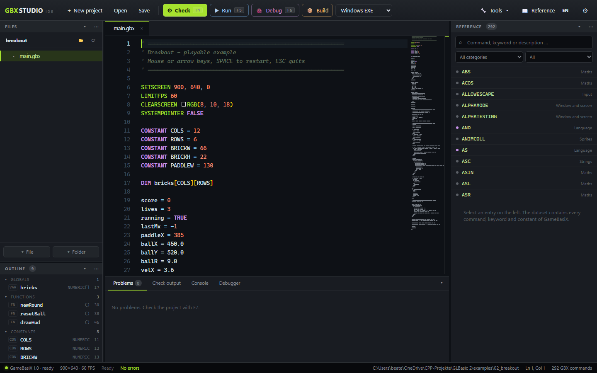

# GBX Studio


The IDE for **GameBasiX**: a code editor with an integrated command reference,
autocompletion, live syntax and name checking, a runtime debugger, and direct
launch of the interpreter. Projects consist of `.gbx` sources plus a
`.gbxproj` file and run on `gbx.exe` – there is no license check.



<sub>Source, outline, command reference and problems side by side, with the
program's window one key press away.</sub>

## Features

* **Editor** – Monaco with GameBasiX syntax highlighting, autocompletion and
  colour swatches in front of literal `RGB(...)` calls. The code between
  `INLINE` and `ENDINLINE` is highlighted by Monaco's C++ tokenizer, and
  `.h`/`.cpp` files open as C++ instead of plain text. The `INLINE` region
  itself keeps its own background, but only in `.gbx` sources. Custom TYPEs,
  FUNCTIONs and METHOD calls are coloured on top of the tokenizer; `CONSTANT`
  names and ENUM values get their own colour, and the ENUM name gets its own as
  well. All four colours are entries of the editor palette in the appearance
  settings (Custom type, Function name, Constant, ENUM).
* **Project commands** – names a project registers with `GBX_INLINE_FN(...)`
  (in an `INLINE` block or in a header) are coloured like built-in commands,
  appear in the completion list with their arity and explain themselves on
  hover with the file and line of their registration. The list is read when a
  project opens and refreshed after every save.
* **Live checking** – half a second after you stop typing, the *unsaved*
  buffer goes through `gbx --check --stdin`. Errors and unknown names appear as
  markers in the line and as a count in the status bar; no temporary files are
  created.
* **Navigation** – `F12` jumps from a name to the file and line that defines
  it, `Shift+F12` lists every use (click jumps there) and `F2` renames a name
  that the project defines itself. The scope decides the range: project symbols
  in every file, a TYPE field in its `TYPE` block and behind every point
  (`obj.feld`), a `LOCAL`, `STATIC` or parameter only inside its routine. The
  search reads the project sources, skips comments, string literals and
  `INLINE` blocks; renaming opens the affected files as tabs and writes them
  when you save.
* **Outline** – globals, constants, functions, SUBs and TYPEs of the current
  file, one click away.
* **Reference** – every command, keyword and `KEY_*` constant with signature,
  description and example, in German and English, searchable and filterable by
  category.
* **Workspace** – files, outline, reference, problems, output, console and
  debugger dock where you drag them, and the columns are resized by dragging
  their edge. The arrangement and the widths belong to the project
  (`.gbxide/project.json`), so a project opens the way you left it.
* **Debugger** – breakpoints (also conditional), step in/over/out, locals,
  globals, call stack, pause-while-running and current values as a tooltip when
  hovering a variable.
* **Build** – a single-file Windows EXE or a self-contained HTML5 folder,
  chosen in the platform dropdown next to **Build**.
* **Themes** – dark and light, plus Google Fonts download straight into the
  project.

## Quick start

Requirements: Node.js 20 or newer and a built interpreter at
`../build/gbx.exe` (see the [project README](../README.md)). Install the
dependencies once:

```bash
cd ide
npm install
npm start          # desktop window (Electron)
```

After that, a double click on **`GBXStudio.exe`** in the project folder is
enough: the slim EXE is only a launcher, finds Electron next to it and opens the
editor window. If Electron is missing it starts the web server and opens the
browser instead. **`GBXStudio_web.exe`** skips Electron entirely and always
starts the web server (its console window closes with Ctrl+C) plus the browser.
Both launchers are built with the rest of the project (`cmake --build build`)
and land directly in the project folder.

Without Electron, in any browser:

```bash
npm run web        # opens http://127.0.0.1:3417/
```

## Configuration

On first start the IDE looks for `build/gbx.exe` next to the IDE folder. A
different path can be set under **⚙ Settings → General** and tested with
**Check**. The same page holds the C++ compiler for `INLINE`. Both fields show
their default as a path relative to the editor EXE (`build\gbx.exe`,
`compiler\bin\g++.exe`) and the resolved path underneath – in a package the
compiler therefore lives at `compiler\bin\g++.exe` with nothing to install.
Absolute paths work as well. The server passes the compiler to every
interpreter start as `GBX_CXX`.

A source checkout has no `compiler` folder, because the toolchain is far too
large for the repository. **Download g++ …** fetches a MinGW-w64 build (WinLibs,
about 260 MB) from GitHub, unpacks it into `compiler\` and reports the version –
the same way **Download** fetches the Emscripten SDK. The folder is reusable:
a second click finds `g++` already in place and does nothing.

When opening or creating a project, folders can be browsed right in the dialog
(up one level, drives, double click on a `.gbxproj` opens it). In the desktop
window the native Windows dialog takes over.

## Working in the IDE

| Action | Shortcut |
| --- | --- |
| Check syntax | `F7` |
| Run the program | `F5` |
| Stop the running program | `Shift+F5` |
| Start the debugger | `F6` |
| Continue to the next breakpoint | `F8` |
| Toggle a breakpoint | `F9` or click the gutter |
| Step over | `F10` |
| Step into | `F11` |
| Step out | `Shift+F11` |
| End the debug session | `Shift+F6` |
| Save | `Ctrl+S` |
| Open a project | `Ctrl+O` |
| New file | `Ctrl+N` |
| Completion | `Ctrl+Space` |
| Accept the suggestion | `Tab` (`Enter` starts a new line, `Space` a space) |
| Toggle the reference panel | `Ctrl+B` |
| Go to definition | `F12` |
| Find all references | `Shift+F12` |
| Rename a symbol in the whole project | `F2` |
| Build the game (selected platform) | `Ctrl+E` |

**Check** calls `gbx --check`. No C++ is compiled: gbx reads the sources on
every start. Messages appear under **Problems** and as markers in the editor; a
click jumps to the line. **Run** saves all files and starts the interpreter in
the project folder. Output from `DEBUG`, `STDOUT` and `STDERR` as well as
runtime errors appear in the **Console**.

**Build** (or `Ctrl+E`) builds for the platform selected in the dropdown. For
**Windows EXE** the sources and the compiled INLINE library end up in a single
EXE, while **assets are copied next to it**. The desktop window asks where to
save; in the browser the file is written to the project folder. For an EXE
without third-party DLLs, point the settings at `build-static/gbx.exe` (built
with `-DGBX_STATIC_RUNTIME=ON`).

A project can be opened as a folder, as a `.gbxproj` or as a single `.gbx`.
Additional source files are created in the file tree and pulled in with
`INCLUDE "lib.gbx"`.

Between `INLINE` and `ENDINLINE` sits C++ (see the
[project README](../README.md#inline-c-inside-the-basic-program)). The IDE
highlights the block as its own region and does not check its lines as BASIC;
**Check** collects the names the block registers with `GBX_INLINE_FN`, including
those from included headers. A block inside code (`FUNCTION`, `IF`, a loop or
`INLINE RUN`) runs at that point on **Run** and sees the BASIC variables there
(names in lower case, texts with `_str`). Arrays can be resized there too
(`push`, `insert`, `remove`, `clear`, `resize` – like `GBXArray`, but directly
on the BASIC array), and built-in GBX commands (`PRINT`, `DRAW_LINE`,
`DELTA_TIME`, …) are called straight from the step.

## Debugger

`F6` saves the project and starts the interpreter with `--debug`. The debug bar
under the tabs shows the state and is driven with `F8`, `F10`, `F11`,
`Shift+F11` or the mouse. While the program runs, **Pause** stops it at the next
statement.

* **Breakpoints** are set and removed with `F9` or a click in the left gutter.
  They belong to the project and survive sessions. Breakpoints added during a
  session apply immediately.
* **Conditional breakpoints**: the pencil icon next to a breakpoint in the panel
  opens a field for a GBX expression (for example `LIVES = 0` or `I >= 4`). The
  breakpoint then only stops when the expression is true in the current scope;
  conditional breakpoints are drawn as a diamond. An expression that cannot be
  parsed is reported and stops instead of silently never matching.
* The **Debugger** panel shows the current function's locals, the globals, the
  call stack and every breakpoint of the project while paused. Clicking a
  breakpoint jumps to its line.
* **Values on hover**: while paused, pointing at a variable in the editor shows
  its current value in the tooltip. Arrays are listed with their indices, a
  `TYPE` with all fields, a `DIM … AS TYPE` array one element after the other,
  and a field array (`bag.items`) the same way (three levels deep, long ones
  abbreviated, so the tooltip stays readable). `player.pos` and `feld[i].name` work as well – the editor takes
  the whole path up to the word under the pointer and has the interpreter
  evaluate it. Names that do not exist at that point show nothing; hovering a
  command never has side effects.
* The paused line is marked in the editor; the file opens automatically, even
  when the breakpoint sits in an included file.

The debugger attaches directly to the interpreter: gbx stops before every
statement and reports position and values as JSON lines on standard output
(prefix `@@gbxdbg `), while commands arrive line by line on standard input. No
separate debug backend or GDB is involved. The value tooltip uses the command
`eval <id> <expression>`: the interpreter answers with `{"t":"eval", …}` and
repeats the id, so the editor can match reply and request. Only names that
exist in the paused frame are evaluated – an unknown name is refused instead of
quietly creating a variable.

**Syntax errors** show up before the start: the debugger already runs while
parsing, reports the error with file and line to the IDE and ends the session.
The message appears under **Problems** and as a marker in the editor – prepared
exactly like `F7`, including a hint for an unknown command.

## HTML5 export

Choose the target **HTML5 (browser)** in the dropdown next to **Build** and
build – this writes a `<project>-web` folder with `index.html`, `gbx.js` (the
interpreter as WebAssembly) and `game.js` (sources and assets). Double-clicking
`index.html` starts the game in the browser; a web server works too.

This needs a one-time wasm build of the interpreter. **Settings → General →
HTML5** provides a dedicated section: **Download …** fetches the Emscripten SDK
into the `emsdk` folder next to the editor EXE (several hundred MB, a few
minutes), **Check** shows the version and **Build player** compiles `src/` to
`html5/gbx.js`. If `html5/gbx.js` already ships with the package, the IDE
exports without the SDK.

`html5/gbx.js.build.json` stores a hash of `src/`, `inline/` and
`third_party/` next to the player. An export compares it: if the sources are
newer than the player, the IDE rebuilds `html5/gbx.js` before copying it (needs
the SDK; without it the export only warns). That way a package never ships a
player that does not know the current commands – the symptom would be a blank
canvas with *unknown command* in the console.

Projects with `INLINE` blocks get their own player on export: the blocks are
compiled with Emscripten and linked in (about 30 s, needs the SDK). The browser
itself has neither a compiler nor `dlopen`.

## Fonts from Google Fonts

**Tools → Google Fonts …** searches the fonts on fonts.google.com, shows them
in the selected style and size, and downloads the `.ttf` into the project's
asset folder (default `assets/`). The dialog names the file and the matching
`FONT_LOAD` line, which can be copied. Without an API key the IDE reads the
public font list and fetches the file through Google's CSS endpoint. A key from
the Google Cloud console can be stored under **Settings → General → Google
Fonts (API key)**; the list then comes through the Webfonts API. The key stays
in the local settings (`config.json`) and is never returned to the interface.
A font's license (usually OFL or Apache) is shown on its Google Fonts page.
TrueType fonts (`FONT_LOAD "x.ttf", …`) run through Emscripten's FreeType port,
so the file has to be part of the project (`assets/` folder or a path in the
`.gbxproj`) – the browser has no Windows font directory.

## Building a library

**Tools → Build library …** compiles C++ files of the project into a static
library. The dialog lists every `.cpp`, `.cc`, `.cxx` and `.c` in the project
(without `build/`, `node_modules/` and `html5/`), lets you tick the sources, name
the library and choose the target – `lib/lib<name>.a` by default. **Build** runs
`g++ -c` for every file and then `ar rcs` for the archive in the bundled
compiler, and prints every line in the dialog. After a successful run the
archive is appended to `[native] libs` of the project file (the rest of the file
is left as it is), so the next start links it into the `INLINE` blocks.

`.c` files are compiled as C++, because the bundled compiler ships only the C++
frontend (`cc1plus`, no `cc1`). Their headers therefore must not ask for
`extern "C"`; a library built with a real `gcc` needs it.

The folder with `gbx_inline.h` is on the include path automatically, so a source
that talks to the interpreter (`#include <gbx_inline.h>`) builds too.
`gbx.exe --inline-cpp bridge.cpp project.gbxproj` writes the C++ of a project's
`INLINE` blocks; drop that file into the project and the dialog turns it into a
`.a`. A C++ program outside GameBasiX can then call those functions – it has to
provide a `GbxHost` itself. The BASIC statements stay interpreted either way;
there is no compiler for them.

## Project file

On save the IDE writes a `.gbxproj` in INI style. It is the same file `gbx.exe`
reads:

```ini
[project]
name = "My game"
main = "main.gbx"

[window]
title = "My game"
width = 800
height = 600
fullscreen = 0
resizable = 1

[graphics]
fps = 60
vsync = 1

[audio]
enabled = 1
volume = 1

[assets]
root = "assets"

[native]                        ; optional: C++ libraries for the INLINE blocks
libs = lib/mylib.a              ; archives (.a) and object files (.o)
libdirs = lib                   ; search folders, passed as -L
flags = -lmy -DFOO=1            ; further flags for the call
```

The same fields are available under **Settings → Project**, including the three
`[native]` fields (libraries, library folders and compiler flags, each space
separated). The section is only written when it is filled, so projects without
libraries keep their usual file. Editor state (open
tabs, the docked panel layout and the column widths) lives in
`.gbxide/project.json`; that folder does not belong in the project archive.

## Command reference and completion

`data/gbx-dataset.json` contains every command, keyword and `KEY_*` constant
supported by GBX, together with signature, description and example.

Each entry describes what the command does in **German and English**; the texts
live in `data/gbx-descriptions.json` and are original wording, not manual
quotes. The active language is shown in the reference panel, in hovers and in
completion. The **DE**/**EN** switch in the top right changes the whole
interface – including messages from the interpreter and the IDE console,
because the IDE sets `GBX_LANG` accordingly. Signature argument names switch
too (`farbe` → `colour`).

Language details (0-based string functions, inclusive `RND`, SDL scancodes,
WAV/MP3 audio, `SCREEN_SCALE`) are noted in the respective entry and in the
“Language details” overview.

Rebuild the dataset after changing the command list in the main README:

```bash
npm run build:dataset
```

## Colour swatches at RGB()

When `RGB(r, g, b)` is called with three numbers – `0x…` included – the editor
shows a small swatch in exactly that colour in front of the call. Showing or
clicking it opens Monaco's colour picker; the chosen colour goes straight into
the source and `Ctrl+Z` takes it back. Comments and string literals get no
swatch, and neither does `RGB(x, y, z)` with variables – their colour is only
known when the program starts.

## Differences from the classic Studio

* **Premium license** – GameBasiX has no license tiers; the license file and the
  license page are gone completely.
* **Compiler integration** – no SDK, no `gpc`, no linking, no platform/`cmp`/
  `lnk` flags.
* **KeyHit tool** – `KEY_DOWN()` takes SDL scancodes; the `KEY_*` constants are in
  the reference.

What remains: the editor, themes, file tree, templates, media preview, reference
panel, outline and the analysis of your own FUNCTIONs and TYPEs. Fonts are
fetched as TrueType files straight into the project via **Tools → Google
Fonts …**; there is no separate bitmap generator any more.

## Tests

```bash
npm test
```

The test starts the server, creates a project, checks a valid and a broken
file, runs a short program headless and verifies exit code and output. It then
runs a debug session through the API: breakpoint, local values, single step and
session end. A built `../build/gbx.exe` is required.

The debug protocol itself is covered by `tools/check_debug.py` (also part of
`ctest`): entry stop, breakpoint, single step, local and global values, session
end and the report of a syntax error.

## Layout

```
src/main/       Electron shell (window, dialogs)
src/server/     HTTP API, project handling, gbx integration
src/renderer/   interface (Monaco, docks, reference, tools)
scripts/        dataset generator and end-to-end test
data/           GBX command dataset, original descriptions (de/en) and source pages
```
